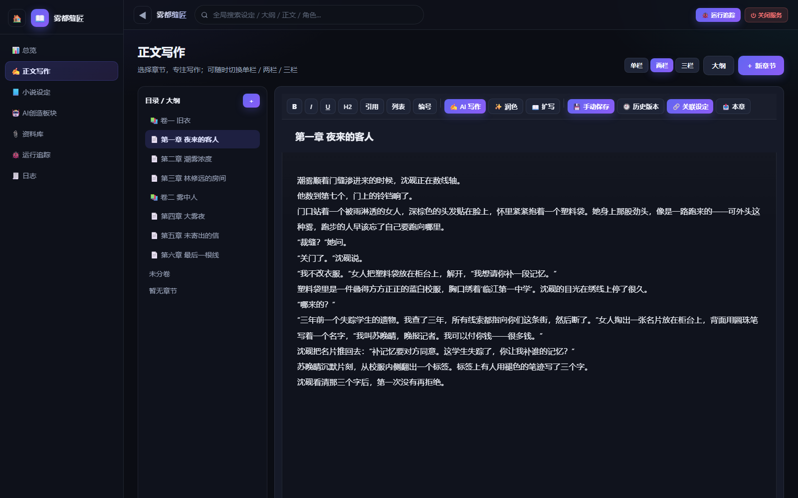
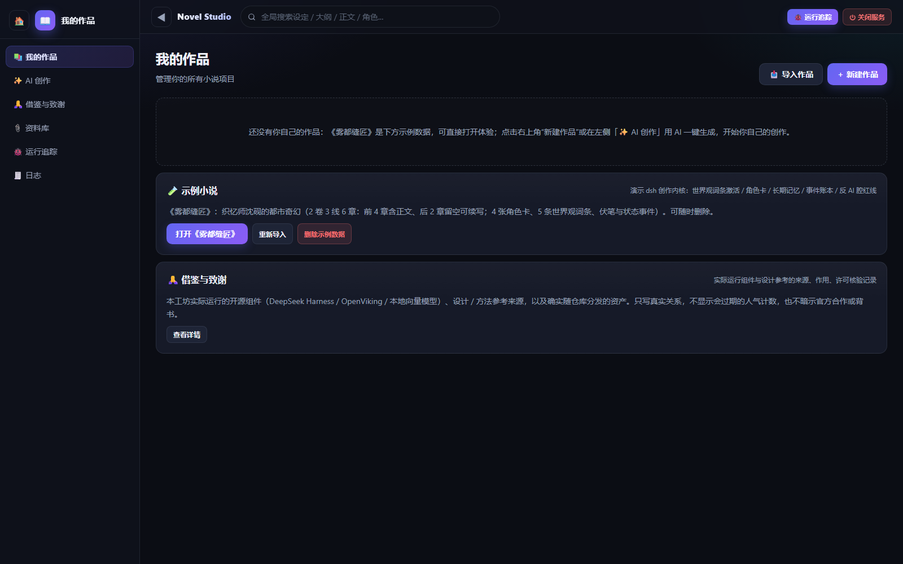
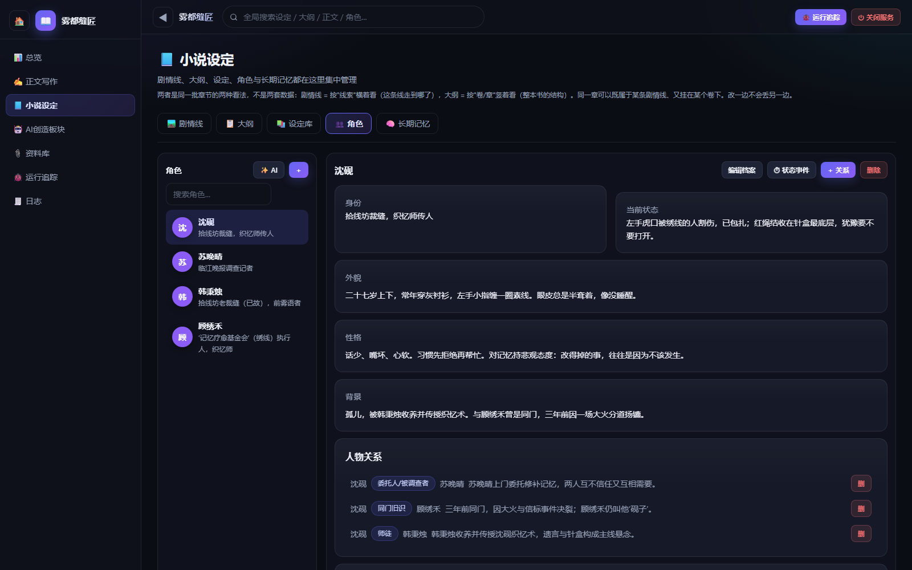
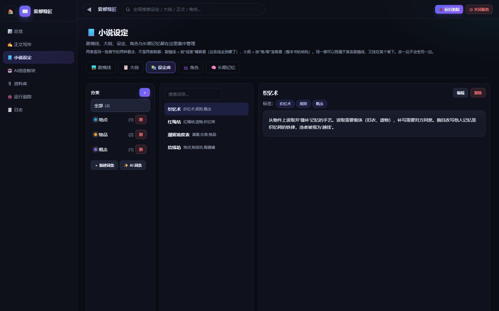

# Novel Studio · 小说创作工坊

**写到第一百章，也不忘第一章埋下的伏笔。**

Novel Studio 是一款开源、**本地优先的 AI 小说写作工具（AI Novel Writing Studio）**，面向长篇小说、网文连载与系列故事。它将**章节编辑器、故事设定库（Story Bible）、人物状态追踪、伏笔管理和一致性检查**放进同一个工作台，让作者更容易发现前后矛盾、维护故事事实。

**本地写作 · AI 可选 · 零 npm 运行依赖。** 基于 Node.js + SQLite，无须注册账号、订阅服务、独立部署数据库或构建前端。

[](https://github.com/bbaz123/novel-studio/actions/workflows/ci.yml)
[](LICENSE)
[](package.json)
[](package.json)

[English README](README.md) · **简体中文** · [新手入门](docs/新手入门.md) · [更新日志](docs/CHANGELOG.md)

> **版本说明：** 本文对应仓库当前默认分支 `Experimental-Version-v1.0`，属于持续迭代的**实验版**，不是旧版 `main` 的使用文档。版本号请以 [`package.json`](package.json) 和 [Releases](https://github.com/bbaz123/novel-studio/releases) 为准。

## 🚀 3 分钟快速开始

**不配置 AI、不购买 API，也能直接开始写小说。** 请先安装 **Node.js 22.13.0 或更高版本**（推荐 Node.js 24）。

```bash
git clone https://github.com/bbaz123/novel-studio.git
cd novel-studio
npm start
```

浏览器打开 **http://localhost:3737**。**不需要执行 `npm install`。**

Windows 用户也可以下载仓库 ZIP 并解压，直接双击根目录的 `start-novel-studio.cmd`。

**第一次打开，建议这样体验：**

1. 在 **「我的作品」** 页面导入内置示例小说 **《雾都缝匠》**，然后打开示例作品。
2. 依次浏览 **「总览 → 正文写作 → 小说设定」**，快速理解章节、人物与设定之间的关系。
3. 点击 **「新建作品」**，创建卷和章节，开始自己的故事。
4. 如果需要 AI 续写或审稿，再去配置模型；**手动写作、设定管理和导出不依赖 AI**。



> 想跟着图文一步步操作？阅读 [《新手入门：从零到写出第一章》](docs/新手入门.md)。运行要求与常见问题可参考下方[安装说明](#-安装说明)。

## ⭐ 主要功能

| 功能 | 可以解决什么问题 |
| --- | --- |
| **长篇小说写作工作台** | 支持多作品、卷、章节、场景；富文本编辑、自动保存、字数统计、多栏布局与历史版本。 |
| **人物一致性检查** | 维护人物档案、当前状态、关系和剧情线中的状态，审稿时提示可能存在的行为或事实冲突。 |
| **伏笔追踪（Foreshadowing Tracker）** | 在事件账本中记录线索，区分未闭合与已回收状态，写到后续章节时可查找未回收伏笔。 |
| **世界观与设定库（Story Bible）** | 集中管理大纲、剧情线、术语、世界设定、角色卡与长期故事记忆。 |
| **AI 上下文装配** | 将 14 层基础创作资料按预算装配进模型上下文，裁剪内容保留查询线索；语义召回为可选能力。 |
| **审稿与局部修订保护** | 提供规则检查、证据核对、局部修订范围约束与作者确认，避免 AI 建议未经审核就直接变成故事事实。 |
| **本地优先、接口开放** | 无 AI 时可离线写作；需要时接入 OpenAI 兼容 API 或可选的 DeepSeek Harness，并通过本地 HTTP API 扩展流程。 |

**请注意：** 规则命中不代表原文一定有错，未命中也不保证没有问题；AI 生成内容和文学质量仍需要作者判断。

## 🎯 为什么需要 Novel Studio？

普通 AI 对话工具可以帮助写出一段文字，却不能仅靠聊天历史可靠维护上百章的故事事实。Novel Studio 的核心思路是：**把人物、事件、设定与伏笔从聊天记录中抽出来，变成可以维护、查询、审查的结构化资料。**

| 长篇创作中的问题 | Novel Studio 的处理思路 |
| --- | --- |
| 第十二章已经死亡或失踪的人物，在第四十章突然正常出现 | 维护人物状态和事件记录，装配相关上下文，并在成文后提示可能的冲突。 |
| 埋下的线索写着写着就忘了 | 用可查询的事件账本追踪未闭合和已回收的伏笔。 |
| 每次调用 AI 都要重新粘贴整本人物设定 | 自动选取与当前章节相关的资料，并按上下文预算裁剪。 |
| AI 润色时顺手改掉了人物关系或故事事实 | 将审稿意见、授权修改范围、修订建议和最终写入确认分开处理。 |
| 不想把全部作品都放在第三方平台 | 默认在本机 `127.0.0.1` 运行，作品使用本地 SQLite 保存。 |

**真正的差异化：** 这是一款**以手稿和故事状态为核心**的写作软件，而不仅是 AI 聊天界面，也不是承诺“点击一下自动写出成品小说”的工具。

### 适合哪些人？

- **网文作者、长篇小说创作者**：需要长期跟踪多卷、多人物、多条剧情线。
- **在意隐私和数据所有权的写作者**：希望稿件存在自己电脑上，AI 可用也可不用。
- **开发者、研究者**：希望研究结构化故事状态、AI 写作工作流或本地 HTTP API。

如果你需要的是开箱即用的**多人云协作、跨设备自动同步**，或未经审稿就直接发表的自动写书服务，本项目暂时并不适合。

### 与其他工具如何选择？

| 主要需求 | 也可以了解 | Novel Studio 侧重点 |
| --- | --- | --- |
| AI 辅助小说成文 | [Sudowrite](https://www.sudowrite.com/)、[Novelcrafter](https://www.novelcrafter.com/) | 本地故事状态、长篇连续性和作者审批流程。 |
| 文件式写作和知识整理 | [novelWriter](https://novelwriter.io/)、[Obsidian](https://obsidian.md/) | 一体化章节编辑、结构化人物状态、事件与伏笔记录。 |
| 与 LLM 自由对话 | [SillyTavern](https://github.com/SillyTavern/SillyTavern)、[Open WebUI](https://github.com/open-webui/open-webui) | 围绕作品章节、故事设定库和成文后检查组织写作。 |

这些工具各有侧重，选择时应以自己的写作习惯为准。

## 🖼 界面截图与示例

下方均为项目内置小说 **《雾都缝匠》** 的实际界面截图，并非设计稿。

| 作品库与示例导入 | 正文写作 |
| --- | --- |
|  |  |

| 人物档案与当前状态 | 设定词条与世界观 |
| --- | --- |
|  |  |

启动后，可以直接从作品库导入示例，体验已经填写好章节、角色、设定、记忆和事件记录的完整工作台。

## 📦 安装说明

| 项目 | 要求 |
| --- | --- |
| **Node.js** | **22.13.0+** 可以运行应用；执行完整验证工具链建议 **22.15.0+**；推荐 Node.js 24。 |
| **系统** | Windows / macOS / Linux。Windows 有可选双击启动脚本；macOS/Linux 使用 `npm start`。CI 覆盖 Windows 和 Linux，但平台特有行为仍可能存在差异。 |
| **浏览器** | Chrome、Edge、Firefox 等现代浏览器。 |
| **其他依赖** | 核心应用无第三方 npm 运行依赖，使用 Node 内置的 `node:sqlite`；无需单独安装 SQLite，也不用前端打包。 |

检查 Node.js 版本：

```bash
node -v
```

**Windows 桌面快捷方式（可选）：**

```powershell
powershell -ExecutionPolicy Bypass -File .\create-desktop-shortcut.ps1
```

**升级：** 先关闭程序并完整备份 `data/`，在当前开发分支拉取最新代码后重新启动：

```bash
git pull
npm start
```

项目支持启动时执行数据库迁移，但不意味着任何升级都可以不备份。卸载时，先停止服务，**保留需要的 `data/` 数据**，再删除程序目录。

## 💻 使用方法

### 1. 手动创作

创建作品、卷与章节，在编辑器中写正文，内容会自动保存。写作过程中，可以通过参考面板查阅人物、剧情线、词条和设定，并持续维护**角色状态、事件记录与伏笔**。

### 2. 可选：接入 AI 写作

进入 **「✨ AI 创作 → ⚙️ AI 设置」**，填写兼容 OpenAI 接口的服务商 **Base URL、API Key 和模型名称**。然后在正文写作界面选择 **「✍️ AI 写作」**，先确认需求，再调用模型。AI 识别的事件和记忆等信息会以提案形式等待审核，不应被理解为自动写入的最终事实。

如果需要更复杂的分阶段创作流程，可以另外配置 **DeepSeek Harness** 和仓库自带的 [`harness-plugins/novel-writing/`](harness-plugins/novel-writing/) 插件。详见 [AI 内核说明](docs/ai-core.md)。**日常写作无需安装 Harness。**

### 3. 可选：通过本地 HTTP API 扩展

启动服务后，在终端执行：

```bash
# 检查服务是否正常运行
curl http://localhost:3737/api/novel/ping

# 通过接口导入自带示例（也可以使用界面按钮）
curl -X POST http://localhost:3737/api/demo/install \
  -H 'Content-Type: application/json' \
  -d '{}'

# 查看作品上下文：将 1 替换为实际存在的作品 ID
curl 'http://localhost:3737/api/novel/context?work_id=1'
```

以上多行 `curl` 示例使用 Bash 格式；Windows PowerShell 可使用 `curl.exe` 并写成单行命令。写入接口有本地来源限制，**不要直接把该服务暴露到公网**。

## 🏗 项目架构

```text
浏览器界面 (public/)
        |
        v
本地 HTTP 服务 (server.js) <----> SQLite (db.js, data/novel.db)
        |
        +--> 故事状态：人物 / 时间线 / 事件 / 伏笔
        |
        +--> 上下文装配：14 层基础资料 + 受控故事状态层
                     |
                     v
                可选 AI 服务
                     |
                     v
                草稿 / 审稿 / 提案
                     |
                     v
                作者确认与修订
```

| 位置 | 作用 |
| --- | --- |
| `public/` | 原生浏览器界面，无需前端构建。 |
| `server.js`、`db.js` | 本地服务器、API、数据库及迁移。 |
| `ai/context/` | 上下文分层、预算、装配和完整性信息。 |
| `ai/story-state/` | 人物、时间线、事件及故事状态。 |
| `ai/continuity-guard.mjs` | 章节成文后的一致性检查。 |
| `harness-plugins/novel-writing/` | 可选的小说创作插件。 |
| `scripts/`、`tests/` | 离线测试与隔离验证。 |

深入阅读：[AI 内核](docs/ai-core.md) · [上下文契约](docs/context-contract.md) · [技术文档索引](docs/README.md)。

## ⚙️ 配置说明

大部分写作和 AI 配置都可以在界面中完成。以下环境变量主要面向开发者与本地多实例使用：

| 环境变量 | 默认值 | 用途 |
| --- | --- | --- |
| `PORT` | `3737` | 本地服务端口。 |
| `NOVELSTUDIO_DATA_DIR` | `./data` | 本地作品数据目录。 |
| `NOVELSTUDIO_DSH_REPO` | 自动检测 | 本地 DeepSeek Harness 代码路径。 |
| `NOVELSTUDIO_OV_DISABLED` | 未设置 | 设为 `1` 时禁用可选 OpenViking 集成。 |
| `NOVELSTUDIO_TRACE_KEEP` | `20` | 保留的运行追踪会话数量。 |

```bash
# macOS / Linux：修改端口与数据目录
PORT=3738 NOVELSTUDIO_DATA_DIR=/tmp/novel-studio-data npm start
```

```powershell
# Windows PowerShell
$env:PORT=3738
$env:NOVELSTUDIO_DATA_DIR="D:\novel-studio-data"
npm start
```

## 🔒 隐私、数据与备份

- **默认只监听 `127.0.0.1`**，作品数据库默认保存在 **`data/novel.db`**。
- `data/` 中可能有**私人稿件、日志和 API 密钥**。虽然目录已被 Git 忽略，仍不要主动提交、分享或打包公开。
- **手动写作可以离线完成。** 但当你主动调用远程 AI 接口时，相关请求内容以及认证信息会发送给所配置的模型服务商。涉及未公开稿件时，请先了解服务商的数据处理政策。
- **正确备份方式：先关闭服务，再复制整个 `data/` 文件夹。** SQLite 使用 WAL 模式，只复制 `novel.db` 可能漏掉最新写入。
- 当前不提供内置多人在线协作或自动云同步。

如发现安全漏洞，请阅读 [安全政策](SECURITY.md)，不要直接在公开 Issue 中披露敏感细节。

## 🧪 验证与项目状态

项目的基础自动化检查旨在**不调用付费 AI 模型**的情况下运行。完整验证工具链需要 Node.js 22.15.0+（推荐 Node.js 24）：

```bash
# 运行仓库配置的离线测试
npm test

# 其他工程检查
node .p1-baseline/verify-phase-map.mjs
node .p1-baseline/check-utf8.mjs

# 使用隔离的临时实例检查 HTTP API
node scripts/ci-isolated-run.mjs --port 3738 -- node api-test-suite.mjs
```

查看：[GitHub Actions](https://github.com/bbaz123/novel-studio/actions/workflows/ci.yml) · [验证状态](docs/nsdsh/STATUS.md) · [平台支持矩阵](docs/nsdsh/support-matrix.md)。请以当前 CI 结果为准，不要把历史通过次数当成永久保证。

本项目仍在**实验版持续迭代**阶段。不同系统、可选运行时和模型质量场景可能存在尚未覆盖的情况；自动检查不能代替作者或编辑的文学判断。

## 🗺 后续方向

以下为当前关注方向，**不代表已承诺的发布日期或完成状态**：

- 更便捷的 macOS / Linux 一键启动。
- 更丰富的作品导出格式（**目前不支持直接导出整书 EPUB / DOCX**）。
- 在保证默认本地安全的前提下，探索可选局域网访问。
- 持续改进人物状态、一致性检查、审稿修订和可选 AI 运行性能。

具体进展请关注 [待决事项](docs/pending-decisions.md) 与 [更新日志](docs/CHANGELOG.md)。

## 🤝 参与贡献

**欢迎提交问题、改善文档、贡献代码，或分享真实写作体验。**

- **发现可复现的 Bug？** [提交 Issue](https://github.com/bbaz123/novel-studio/issues/new/choose)，附上操作系统、Node 版本、复现步骤和必要的错误信息。
- **有使用问题或新功能想法？** 在 [Discussions](https://github.com/bbaz123/novel-studio/discussions) 交流。
- **准备提交 PR？** 请先阅读 [CONTRIBUTING.md](CONTRIBUTING.md)。核心应用遵守零 npm 运行依赖和 ESM 等约束，较大的改动建议先讨论方向。
- **发现安全问题？** 请按 [SECURITY.md](SECURITY.md) 的方式私密报告。

如果这个项目帮助你更好地管理长篇创作，欢迎给仓库一个 **Star ⭐**。你的反馈、Fork 和改进建议，都能帮助项目持续完善。

## 📄 开源协议与致谢

Novel Studio 以 **[MIT License](LICENSE)** 开源。仓库中打包的部分第三方材料可能适用不同许可证，请阅读 [THIRD-PARTY-NOTICES.md](THIRD-PARTY-NOTICES.md)。

可选的 AI 创作集成使用 [DeepSeek Harness](https://github.com/deepseek-ai/deepseek-harness)；更多设计背景与依赖说明见应用内「借鉴与致谢」及 [技术文档](docs/README.md)。

---

**故事可以天马行空，已经写下的事实值得认真管理。**
