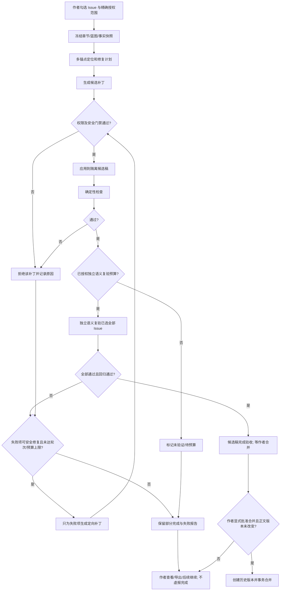

# Novel Studio UI 重构与修稿质量闭环实施方案

> **文件名：`ui方案.md`**  
> **文档类型：正式产品 / 交互 / 前端组件 / 状态管理 / 安全验收 / 联调实施方案**  
> **状态：设计基线（待在用户本地源码上实施与验证）；不是已经完成的程序改造报告。**  
> **适用项目：** [bbaz123/novel-studio](https://github.com/bbaz123/novel-studio)  
> **协作环境：** Novel Studio + 可选 DSH `0.2.0-rc.2` 自动方案执行插件；现有 `dsh-confirmation-resolution` 保留独立职责。

---

## 0. 一页结论与不可改变的约束

本轮不是把原 UI 做得更花哨，而是**解决写作区被挤压、设置页纵向堆叠、修稿结果缺乏可信闭环**三个实质问题。必须同时交付：

1. **写作台轻量化：**保留原有左侧目录/大纲、中间正文、右侧参考资料与本章状态。仅在“本章状态”处增加单行修稿入口；不在正文或差异预览顶部永久叠加大号验收面板。
2. **独立审稿工作区：**从写作台切换到占用主内容区域的专用工作区；其结构为紧凑工具条 + 折叠式验收摘要 + 左侧问题导航 + 主差异对照 + 仅按需弹出的详情抽屉 + 当前阶段操作条。
3. **时态状态引擎独立设置页：**“角色与事实状态”和“时态引擎设置（迁移与开关）”成为并列入口；进入和展开引擎设置绝不改变写作台列宽。角色条目改用可搜索、筛选、虚拟滚动的紧凑列表/表格。
4. **修稿质量闭环：**用户勾选的每个问题都须经过“授权 → 定位 → 补丁 → 安全门禁 → 确定性检查 → 独立语义复验 → 必要时定向复修 → 全量回归验收”。**补丁应用 ≠ 问题解决；复验未运行 ≠ 已通过。**
5. **合并安全：**所有改动首先进入候选稿；只有作者明确执行“合并到正文”，才可在版本并发检查、备份和事务保护下改动正式正文。未通过项目允许查看/导出候选稿，但不得虚报“全部通过”。
6. **最小改造：**尽量复用项目当前修稿后端、状态引擎、数据库与前端样式；新增工作区壳层、适配器、状态契约与验收连接，不无理由重写原有核心管线。

### 0.1 版本声明（最高优先级的项目约定）

> **GitHub 上的版本 = 我本地的版本。GitHub 上的版本永远不会高于我本地的版本，因为 GitHub 上的代码是我从本地上传的。**

落实为工程规则：

- **本地项目是权威工作源（source of truth）**，GitHub 是由作者本地上传的版本副本，不以远端展示的版本、README 标记、实验分支、某个代码注释，推断用户本地代码“落后”。
- 在同步完成的发布点，**版本号应一致**；本地存在尚未上传的改动时，允许本地提交状态领先远端，但**不得宣称 GitHub 比本地新**。
- 历史讨论曾明确在 `v1.2.1` 环境分析问题；后续也出现 `v1.2.3 → v1.2.4` 的建议性表述。**它们都不是当前本地版本的自动证明。**开始实施时必须读取本地 `package.json`、当前分支、工作树和实际服务构建信息，记录为 `BASELINE_VERSION`、`BASELINE_COMMIT`。
- 公共仓库当前某分支显示的版本字符串仅作为**分支元数据**核查，不得触发自动 `git pull`、强制检出、覆盖本地、升级依赖或擅自发布。版本标签冲突时先核实路径、分支、提交与实际运行进程，并记录差异。
- 本方案**不预先规定必须升级到任何版本号**。只有功能实现、测试与作者要求的发布流程完成之后才提出版本号变更；`GitHub push/release` 不是本轮 UI 修改的隐含授权。

### 0.2 事实、假设与新增设计的边界

- **来自已确认使用情境：**写作台是多栏；右侧有资料和本章状态；“时态状态引擎（迁移与开关）”与较长角色状态内容同页；用户已全部勾选过八条审稿问题，但修后仍有未解决项；现有界面缺少直观的逐项完成证明。
- **来自历史源码分析、需要本地复核：**`public/app.js` 的修稿和差异展示入口、`revision-semantic-verifier.js`、`revision-closure.js`、长文分段修稿路径、局部补丁门禁、可选独立语义复验，以及修稿预览中的复验结果传递链。此处把它们当作**待现场映射的已有能力**，不保证每个本地函数名与历史一致。
- **本方案新增约定：**完整的数据模型、视图路由、定向复修状态机、预算前置授权、响应式尺寸、并发与回滚规则、验收矩阵。这些是**实施要求**，不是已存在功能或已通过测试的声明。
- **示意数据禁止混淆：**文中如“8 项选中、3 项通过、5 项未通过”仅用于解释界面位置，不代表这次实际运行记录。正式界面数据必须来自当前 `revision_run` 的真实验收状态。

---

## 1. 目标、范围与不做什么

### 1.1 功能目标

- 打开、关闭或切换“时态状态引擎设置”时，写作台正文可用宽度不变化；不会出现一次点击让正文严重压缩的现象。
- 审稿工作区始终以**阅读、定位、修改差异**为主要面积；详情、时态设置、复验日志只在用户按需查看时显示。
- 八条审稿意见全部勾选时，每条均能追踪：选择状态、允许修改的范围、定位结果、补丁状态、安全验收、独立语义复验结果、必要的定向复修次数、失败原因及证据。
- 一次修稿跨越短章/长章、单次/分段等路径，输出**同一种验收数据结构**。
- 刷新、返回写作台、切换章节、恢复会话时，保留候选稿、审核选择、进度与审批状态；不能重复收费、重复合并或重复应用补丁。

### 1.2 非目标与边界

- 不重做整个 Novel Studio 视觉品牌，不强制引入 React/Vue/新的 UI 框架，不以 UI 名义改写小说正文。
- 不把独立审稿工作区与时态引擎的迁移、重建、写库操作混在一个页面内。
- 不为了“绿灯全过”而跳过安全门禁、降低既有世界观约束或伪造语义复验。
- 不替作者勾选额外问题、不自动扩大编辑授权范围、不自动将候选稿合并为正式正文。
- 不假定 DSH 和确认插件实际安装、在线或双插件已成功联调；这些必须在本地环境检测后确认。

### 1.3 核心术语

| 术语 | 定义 | 是否意味着完成 |
|---|---|---|
| 审稿问题 Issue | 审稿器发现的待修改项，带原文证据与验收标准 | 否 |
| 作者授权 Selection/Scope | 作者选中了哪些 Issue，以及准许编辑哪些精确文本范围 | 否 |
| 补丁 Patch | 对授权跨度的局部修改提案 | 否 |
| 候选稿 Candidate | 安全地应用补丁后的独立稿件版本，尚未覆盖正文 | 否 |
| 确定性检查 | 范围、结构、受保护内容、可计算一致性等检查 | 不是语义完成 |
| 独立语义复验 | 对**原 Issue 的验收标准**逐项重新评价修后的内容 | 通过才可证明语义解决 |
| 定向复修 | 只对失败、部分解决或有证据不足的 Issue 进行下一轮有界修改 | 仍需再验收 |
| 合并正文 | 作者在已审阅差异后将某候选稿写成新的正文版本 | 独立于验收 |

---

## 2. 信息架构和导航重新分工

```text
Novel Studio
├─ 作品空间
│  ├─ 作品总览
│  ├─ 写作台（原有三栏结构保留）
│  │  ├─ 目录 / 大纲
│  │  ├─ 正文编辑器
│  │  ├─ 参考资料 / 本章状态
│  │  └─ 单行入口：审稿与修稿（仅有相关任务时出现）
│  ├─ 审稿工作区 /reviews/:chapterId/:runId?
│  │  ├─ 审稿问题清单
│  │  ├─ 修稿计划 / 授权跨度
│  │  ├─ 差异预览 / 候选稿
│  │  ├─ 逐项验收与定向复修
│  │  └─ 合并正文 / 历史记录
│  ├─ 故事设计
│  └─ 故事状态与工具
│     ├─ 角色与事实状态（独立子页）
│     └─ 时态引擎设置（迁移与开关）（独立子页）
└─ 辅助与诊断
   ├─ 运行追踪 / 日志
   └─ 版本与健康检查
```

**禁止设计：**把审稿的总统计卡片永久固定在三栏写作台正文上方；把时态引擎开关嵌在展开数十个角色信息卡的末尾；把第四栏诊断面板永久挤入差异对照。

### 2.1 导航与路由规则

- 由写作台点击“审稿与修稿”进入独立工作区，页面保留 `workId/chapterId/runId`，可复制深链接。
- 返回写作台时恢复章节、正文光标或最近滚动位置；审稿工作区恢复当前选择的 Issue、差异视图模式、筛选条件与滚动锚点。
- “审稿工作区”“时态引擎设置”**互不套嵌**；打开设置页时不同时保留写作台的目录/右侧设定栏。
- `Back/Forward` 应仅恢复 UI 状态，**不得重复触发任何付费调用、生成补丁或合并请求**。
- 离开有未合并候选稿的页面，保存草稿状态；如当前有未完成的不可撤销写入，给出明确的阻止或安全离开说明。

---

## 3. 空间布局与响应式规则

### 3.1 正常写作台：仅一行状态入口

在原“本章状态”区域内显示下列之一：

- **无审稿任务：**不显示新增统计。
- **有运行中任务：**`审稿与修稿 · 正在复验第 2 轮  · 查看`。
- **有未解决问题：**`修稿验收 · 5/8 待处理 · 查看`（状态由真实运行返回）。
- **所有已选问题已通过：**`修稿验收 · 已选项全部通过 · 查看差异`（**不等于已合并**）。
- **复验尚未运行：**`修稿已生成 · 尚未语义复验 · 查看`，不得写成“完成”。

该入口为单行、可截断、可点击的状态，不引入折叠大卡片，不占据正文视口的主要高度。详情全部进入独立工作区。

### 3.2 独立审稿工作区（宽屏）

```text
┌───────────────────────────────────────────────────────────────────────────┐
│ ← 返回写作台   审稿与修稿 / 本章标题                   状态 · 版本 · 关闭 │ 52px
├───────────────────────────────────────────────────────────────────────────┤
│ 验收摘要：已选8 · 通过3 · 待处理5  ━━━━━░░░   复修1/3   [展开详情]      │ 44–56px
├───────────────┬───────────────────────────────────────────────────────────┤
│ 问题导航      │ 只看变化 / 上下文 / 全文     差异对照 / 行内差异        │
│ 搜索/筛选     │ ┌─────────────────────┬──────────────────────────┐   │
│ #1 ... 状态   │ │ 修前片段            │ 修后候选片段             │   │
│ #2 ... 状态   │ │ 定位高亮            │ 变动高亮、受保护标记     │   │
│ #3 ... 状态   │ │                     │                          │   │
│ ...           │ └─────────────────────┴──────────────────────────┘   │
│               │ 当前选中问题：锚点 / 复验结论 / 失败原因（精简）       │
├───────────────┴───────────────────────────────────────────────────────────┤
│ [查看授权范围]  [复验]  [定向复修失败项]   [候选稿操作]  [合并到正文]  │ 56–64px
└───────────────────────────────────────────────────────────────────────────┘

“证据、详细原因、历史日志、费用明细”点击后以覆盖式详情抽屉出现：
┌────────────────────────────────┐
│ 详情抽屉 300–360px（覆盖浮层）│  不改动主差异区宽度
└────────────────────────────────┘
```

关键：**不做常驻高统计面板、第四列或内联长日志。** 紧凑摘要只承担状态导航作用；长报告可展开到抽屉或独立报告视图。

### 3.3 尺寸令牌

| 部位 | 设计范围 | 行为 |
|---|---:|---|
| 工作区导航 | 48–56px，默认 52px | 顶部固定于工作区 |
| 紧凑验收摘要 | 44–64px，默认约 52px | 一行摘要；内容溢出时折叠 |
| 问题列表 | 240–280px | 大屏可折叠；内部独立滚动 |
| 主差异区 | `minmax(0, 1fr)` | 最高优先级；允许长文本虚拟化 |
| 详情抽屉 | 300–360px | **覆盖式**；默认关闭，不挤压主面板 |
| 底部操作 | 52–64px | 只显示当前阶段合法动作 |
| 水平页面内边距 | 大屏左右各约 16px | 小屏按实际空间缩减 |

这些尺寸是**推荐设计令牌而非声称现有 CSS 已应用**。实施时可在浏览器调试器中根据实际字体和缩放校正。

### 3.4 响应式行为与空间验证

| 浏览器可用宽度 | 默认问题导航 | 差异显示 | 详情 |
|---|---|---|---|
| `≥1280px` | 左侧 240–280px 常驻，可折叠 | 双栏修前/修后 | 叠加抽屉 |
| `800–1279px` | 44px 图标轨道或覆盖式抽屉 | 默认行内/单栏，可按需切双栏 | 叠加抽屉 |
| `<800px` | 隐藏，入口打开覆盖式抽屉 | 单栏逐段对照 | 覆盖全屏/底部抽屉 |

计算示例（只计页面内边距与列表列宽，不计实际浏览器滚动条；用于设计空间自检）：

- 1280px 宽：主体约 `1280 - 32 - 240 - 12 = 996px`，双栏时每侧约 `498px`。
- 1650px 宽：主体约 `1650 - 32 - 280 - 12 = 1326px`，双栏时每侧约 `663px`。
- 800px 宽：图标轨道模式主体约 `800 - 32 - 44 - 12 = 712px`。
- 390px 宽：单栏去掉左右各 12px 后可用约 `366px`。
- 因浏览器滚动条、缩放和系统字体会变化，真实落地应测量 `clientWidth` 和文本换行，不能只凭上面的估算判定 UI 通过。

**硬验收：**打开详情抽屉不改变 `.review-main` 的宽度；切换“时态引擎设置”不改变写作台编辑器的列宽；工作区内部不产生异常的全页横向滚动。

### 3.5 竖向空间

工作区内建立独立滚动容器：头栏与当前操作条保持可见；问题列表和差异视图各自滚动。验收摘要在极窄屏可隐藏为状态徽记，但不能隐藏“尚未复验/部分完成”这类关键信号。

---

## 4. 审稿工作区页面结构与交互

### 4.1 四阶段进度条

**阶段 1 审稿清单 → 阶段 2 生成修稿 → 阶段 3 逐项验收 → 阶段 4 审阅与合并**

进度条是流程导航，不是成功指示器；“进入阶段 4”不表示全部问题已经通过。各阶段的状态、操作、允许回退如下：

| 阶段 | 显示的主要内容 | 可执行操作 | 不允许 |
|---|---|---|---|
| 审稿清单 | Issue 列表、来源、原文锚点、可编辑范围、所需费用预算 | 勾选/取消、细化授权、冻结本轮 | 自动默认全选、扩大授权 |
| 生成修稿 | 计划、候选补丁数、安全门禁、具体失败原因 | 开始、暂停、取消、查看差异 | 覆盖原稿 |
| 逐项验收 | 每项确定性结果、独立语义结果、未通过清单、轮次、成本 | 验证、定向复修、查看证据 | 未复验标记通过、无界无限重试 |
| 审阅与合并 | 最终候选稿、未解决项、变化范围、版本冲突、备份 | 显式合并、另存候选、退出 | 后台静默合并、对冲突强行覆盖 |

### 4.2 问题列表要同时呈现三个维度

每个 Issue 至少有：

1. **授权态：**`未选 / 已选 / 范围不足 / 受保护 / 方案冲突`。
2. **操作态：**`待处理 / 已定位 / 补丁待验 / 候选稿已应用 / 生成失败 / 冲突阻塞`。
3. **验证态：**`未运行 / 待预算 / 运行中 / 通过 / 部分通过 / 不通过 / 证据不足 / 验证异常`。

不得把不同维度挤成一个含义不明的“已修复”徽记。列表默认展示一行标题 + 一个最重要的状态；完整三维状态展开详情查看。

### 4.3 选择 Issue 后的动作

点击 `#3 母亲行程矛盾` 之类条目：

- 锚点定位：选择本项所有证据位置（可能横跨章节两端），高亮并同步滚动修前/修后。
- 差异过滤：自动仅显示与该 Issue 相关的补丁和足够前后文；可切换“全部改动”。
- 失败说明：显示 `未通过：原时间矛盾仍存在`、相关文本证据、允许的修复建议；点击“复修此项”并进入有界流程。
- 审核足迹：可查看这一项为什么被跳过、安全门禁拦截、预算不足或语义判定未确定。
- 不得因“切换 Issue / 查看差异”触发模型调用或产生新补丁。

### 4.4 差异浏览模式

- **只看变化（默认）：**收起未变化段落；每处差异保留必要上下文与“展开上下文”按钮。
- **带上下文：**展示变动前后邻近段落，保证可判断文意。
- **完整正文：**长文虚拟化/分段渲染，支持查找、高亮、跳转锚点。
- 宽屏默认双栏；窄屏默认行内差异。保留同步滚动、行/段落锚点；对插入/删除采用稳定 `hunk_id` 不能单靠字符偏移。
- 保护区改动必须显式警告；无关改动和过大范围改动必须视为风险，而非 UI 可隐藏的细节。

### 4.5 摘要与报告

紧凑摘要真实汇总：`已选 N / 独立复验通过 P / 仍未通过 F / 未验证 U / 其他阻塞 B`，且必须满足 `N = P + F + U + B`（分类互斥；“部分通过”归入未通过并显示子类）。

- 成功判定以**最新一轮、完整已选集合**的复验快照为准。
- 当复修又影响已经通过的项目时，允许原先 `PASS` 回退为 `FAIL`，不能使用只增不减的计数器。
- 任何统计结果都显示 `run_id / candidate_version / verification_round`；没有数据时显示 `—`，不得用假数字填空。
- 抽屉提供逐项报告、模型费用记录、补丁明细、门禁记录和导出 JSON/Markdown 的入口。

---

## 5. 时态状态引擎：从挤压页面迁移为独立设置视图

### 5.1 导航位置

在“故事状态与工具”下分出两个同级入口：

- **角色与事实状态：**默认列表/表格，适合日常检查已知、显式不知道、怀疑、误信、未定义等状态；只展示必要摘要。
- **时态引擎设置（迁移与开关）：**独立配置页，展示开关、数据迁移/健康、逐章重建、自动分析、模式和状态版本；与角色清单物理分离。

进入这些页面应替换主内容，而不是在角色条目下方追加一个越来越长的区块。

### 5.2 角色状态页

默认列：角色名称、可行动项数、已知、显式不知道、怀疑、误信、未定义、最近更新章节、异常。列多时可选择性隐藏低频列，搜索/筛选与排序固定于表格头部。

- 搜索角色名、别名、章节；
- 按异常、待补事实、状态分类筛选；
- 点击一行打开角色详情抽屉或子视图；
- 默认**不展开**每个角色长卡片；
- 大量角色数据分页/虚拟化，空状态显示原因，不制造“暂无数据即成功”的误导；
- 行状态与计数来自真实 API；界面不读写设置页中的开关状态。

### 5.3 时态引擎设置页

逻辑分组：

1. **运行状态（只读）：**当前启用模式、版本、最近重建时间与结果、数据健康状态。
2. **功能开关：**启用/停用、自动分析、状态维护策略。切换前显示影响范围；禁止页面加载时自动切换。
3. **迁移与重建：**检测兼容性 → 备份 → 预检查 / 试运行 → 作者授权 → 迁移 → 健康验收；单次可见进度和失败恢复点。
4. **诊断与历史：**失败原因、版本记录、迁移报告与回滚入口。

任何迁移/重建都是显式操作；**仅打开设置页不执行迁移，也不改变角色状态数据**。迁移必须具备幂等性、可恢复检查点、数据库备份、破坏性变更授权和失败回滚计划。

### 5.4 审稿与时态引擎的边界

独立审稿工作区只请求**相关章节的世界观/人物/事实只读快照**并记录快照版本。校验器可引用这些状态作为判据；不得在修稿 UI 内直接显示或修改“时态引擎（迁移与开关）”设置，不得因一次语义复验触发状态迁移。

---

## 6. 用户授权与修稿权限契约

### 6.1 两次独立授权

- **授权 A：本轮修稿。**作者选中 Issue，系统将可编辑跨度、相关可核验原文、保护范围和模型预算明确列出。选择问题**不等于授权改写整章**。
- **授权 B：最终合并。**作者查看最终候选稿和验收结果后明确点击合并；不得把“允许 AI 修稿”推定为“允许覆盖原稿”。

对于 `PARTIAL / FAIL / UNKNOWN / BLOCKED` 的候选稿：可以查看或导出；如产品提供“带未完成事项的部分合并”，必须由作者另行明确选择，并保留未解决清单、警示和可回退版本；**不得显示为“全部完成”**。

### 6.2 保护范围

至少区分：

- 作者**未勾选**的 Issue；
- 未授权的正文跨度；
- 蓝图硬约束、剧情目标、关键伏笔和世界观的硬事实；
- 强制不变的写作禁区和受保护段落；
- 其他章节/作品的内容；
- 时态引擎数据库及状态迁移结果。

任何补丁造成越界、覆盖保护区、事实矛盾升级或缺少有效定位时，安全门禁直接阻断该补丁，不应通过 UI 绕过。

---

## 7. 数据契约：Issue、Run、Patch、Verification

> 下列是**建议字段契约**。接入时优先映射项目既有字段；不可用时再在兼容迁移中新增。不得凭空宣称当前库表已具备这些字段。

### 7.1 `ReviewIssue`

```json
{
  "issue_id": "I003",
  "review_id": "review_xxx",
  "chapter_id": "chapter_xxx",
  "title": "母亲夜班时间线矛盾",
  "category": "continuity",
  "severity": "high",
  "original_requirement": "同一时间线中的母亲交班与回家时间必须自洽",
  "evidence_spans": [
    {"anchor_id": "a1", "quote": "原文证据A", "context_hash": "..."},
    {"anchor_id": "a2", "quote": "原文证据B", "context_hash": "..."}
  ],
  "acceptance_tests": ["跨段时间顺序一致", "未改变既定家庭设定"],
  "source_review_snapshot_id": "review_snapshot_xxx"
}
```

一个 Issue 可以拥有**多个关联证据跨度**；不允许像旧式“单热点”那样默认只定位一处就宣布解决。找不到足够证据时，状态必须是 `LOCATE_FAILED` 或 `NEEDS_SCOPE`，不能胡乱编辑。

### 7.2 `RevisionRun`

```json
{
  "run_id": "rev_xxx",
  "work_id": "work_xxx",
  "chapter_id": "chapter_xxx",
  "base_chapter_version": "v_chapter_007",
  "base_content_hash": "sha256:...",
  "frozen_blueprint_hash": "sha256:...",
  "selected_issue_ids": ["I001", "I003"],
  "authorized_spans": [],
  "protected_spans": [],
  "candidate_id": "cand_xxx",
  "candidate_content_hash": "sha256:...",
  "stage": "VALIDATING",
  "max_targeted_repair_retries": 2,
  "targeted_repair_retries_used": 0,
  "verification_round": 1,
  "latest_validation_snapshot_id": null,
  "budget": {"limit_cny": null, "spent_cny": 0, "authorized": false},
  "merge_approved_by_author": false
}
```

`max_targeted_repair_retries = 2` 是推荐默认值：初次修稿后最多再进行两次有界定向复修，形成最多三轮“初次 + 复修”机会。此上限可配置但**绝不可无限循环**。

### 7.3 `IssueOutcome`

```json
{
  "run_id": "rev_xxx",
  "issue_id": "I003",
  "authorization_state": "SELECTED",
  "operation_state": "PATCH_APPLIED_TO_CANDIDATE",
  "deterministic_state": "PASS",
  "semantic_state": "FAIL",
  "final_state": "FAIL",
  "reason_code": "TIMELINE_CONTRADICTION_REMAINS",
  "evidence_refs": ["candidate-span-8", "candidate-span-41"],
  "patch_ids": ["patch_1"],
  "validator_version": "local_verified_version",
  "verified_candidate_hash": "sha256:...",
  "verification_round": 1,
  "repair_attempts": 0,
  "last_updated_at": "ISO8601"
}
```

### 7.4 状态规则

- `final_state = PASS` 只能在当前 `candidate_hash` 的确定性检查通过、且当前 Issue 的**独立语义复验通过**、必要的全局回归无阻断时产生。
- 未进行语义复验：`UNKNOWN`/`VERIFY_PENDING`，**绝不映射为 `PASS`**。
- `PATCH_APPLIED_TO_CANDIDATE` 只是操作态；不能直接映射为 `PASS`。
- 审核器升级、候选稿变化、世界状态快照变化、Issue 原始要求变化时，已有证明可能失效；相关项必须重新验证。
- `PASS` 允许在后续修订后退回 `FAIL/PARTIAL/UNKNOWN`，以最新有效校验快照为准。
- 任一失败项具有 `reason_code`、证据和下一步；确实无证据时显示 `INCONCLUSIVE` 而不是猜测。

---

## 8. 修稿失败项定向复修：完整操作流程

这是本次改造的**核心业务规则**，与 UI 组件同时实施。

### 8.1 总流程



### 8.2 分步 SOP（不可跳序）

**S0 — 预检和恢复。**读取已存在 `run_id`，校验章节 ID、候选稿哈希、版本、选中清单与现有进度；有已验证且仍适用的结果就复用，禁止重复扣费和重复修改。

**S1 — 冻结原始依据。**保存原稿快照、用户勾选清单、授权跨度、蓝图约束、作品事实快照、世界观硬条件、复验标准和预算授权。作者后来改动正文，不能悄悄修改这份审稿依据。

**S2 — 多证据定位。**每项 Issue 可能跨多处：例如“开头两折、结尾一折”“两处时间叙述冲突”“多次重复规则解释”。建立证据集合和编辑候选跨度；只有真实存在且具备稳定锚点的位置才可编辑。

**S3 — 编译授权范围。**把可编辑范围与受保护范围独立记录；编辑两处须有两处的授权，不能以“修复第 3 项”为名扩展到整章。多个 Issue 共享跨度时先建立冲突图，避免补丁互相覆盖。

**S4 — 生成定向修复计划。**每项计划写明：原问题、根因假设、预期修复效果、允许改哪些位置、不能动什么、确定性检查项和语义复验问题。跨段问题可选择只调整其中一处，但必须最终复验两处。

**S5 — 提议补丁。**模型输出结构化、可追踪的局部补丁及原因，不直接写正文；请求参数绑定 `base_content_hash`、`run_id`、`issue_ids`、`attempt_id`。

**S6 — 安全门禁（见第 9 节）。**校验真实授权、补丁边界、引用上下文、蓝图约束、受保护段落、版本一致性、差异规模与依赖。任一硬门禁失败则拒绝，记录结构化原因，不生成“成功应用”假状态。

**S7 — 应用到候选稿。**采用幂等补丁 ID，在隔离的候选内容上合并；重试不能重复应用，失败不得污染正式正文。保留每一轮候选与回滚点。

**S8 — 免费/确定性检查。**比对保护区哈希、非授权改动、语法与标记完整性、世界观中的结构化硬事实、锚点存活、叙述顺序可计算条件、篇幅硬约束等。不能把它当作完整语义复验。

**S9 — 独立语义复验。**在作者已经批准的预算内，通过与补丁生成**相互独立的复验步骤**逐条判断原 Issue 是否解决；读取全部关联证据和必要上下文，生成 `PASS/FAIL/PARTIAL/INCONCLUSIVE`、理由和原文/候选稿证据。若无授权、预算不足、接口失败，标记 `UNKNOWN/WAITING_BUDGET/VERIFY_ERROR`，不能放行。

**S10 — 仅对失败项定向复修。**将 `FAIL/PARTIAL`（以及补证据后可修复的 `INCONCLUSIVE`）放入下一轮队列；排除 `PASS` 但保留这些项的回归保护。复修请求包含最新候选稿、最新失败证据、未变更的原始验收目标、限界跨度，不允许重新润色全章。默认最多 2 次额外复修；相同原因连续失败则暂停该项并输出阻塞。

**S11 — 全集合回归验收。**每次补丁后对**本轮全部已选 Issue**及相关世界状态约束重新检查；防止修复 A 破坏 B。完成状态来自此轮最新全量结果，而不是把历次 PASS 拼接成一个假“全部通过”。

**S12 — 展示结果与等待作者合并。**全部验证通过时显示“已选项全部通过，候选稿待合并”；存在遗留时显示“部分完成 / 未全部通过”，可查看每项理由、审阅和导出。最终正文合并仍需作者明确同意与写入前并发校验。

### 8.3 定向复修不是重新“全文洗稿”

下一轮模型输入只能包含：

- 当前**原始** Issue 的标题、必要证据、验收标准与修复失败原因；
- 当前候选稿中必要的邻近上下文/关联位置；
- 本次允许编辑的跨度、受保护内容、蓝图/时态事实硬约束；
- 上轮补丁与失败日志、禁止重复的无效尝试；
- 输出格式：精确补丁、预期影响与可验证条件。

不传入无关章节要求模型大改，禁止改变未授权设定以换取局部审稿成功。

### 8.4 费用及超时策略

- 独立语义复验和 AI 定向复修可能产生费用。界面在第一次付费调用前显示：调用用途、次数上限、预计费用、**本轮累计预算**，由作者明确授权；没有预算授权时仅执行免费检查，并标记“待语义复验”。
- 与 DSH 自动方案执行插件协作时，沿用已确定的费用约束：**单次收费操作不得高于人民币 2 元；如未明确扩大累计授权，则默认整个自动任务累计上限同样为 2 元**。不得通过拆单绕过上限。若 Novel Studio UI 的独立会话预算另有明确作者设置，以**更严格的有效上限**执行。
- 若 API 无法可靠提供价格或已用额度，不可假定仍有预算；可以尝试免费路径或等待作者确认，绝不虚构扣费成功。
- 模型网络错误/取消/超时：任务保留可恢复状态；已发起的调用不得因页面刷新被重复发起。返回晚于取消或旧候选版本的结果须丢弃或隔离，不能写入新状态。
- 自动复修只在**可证明授权、可合理定位、成本可控、硬门禁无阻塞**的条件下继续。

---

## 9. 安全验收门禁：强制执行且不可绕过

### 9.1 硬门禁清单

| 代码 | 验收门禁 | 失败时处理 |
|---|---|---|
| `G01_AUTHOR_SELECTION` | 目标 Issue 必须实际被作者勾选 | 不生成补丁 |
| `G02_EDIT_SCOPE` | 实际变动全部落在允许的精确跨度 | 拒绝越界补丁 |
| `G03_PROTECTED_TEXT` | 受保护段落、其他章节和设定不可被擅改 | 拒绝、保留候选 |
| `G04_ANCHOR_INTEGRITY` | 原文锚点可唯一定位、上下文哈希匹配 | 标记需重新定位 |
| `G05_BASE_VERSION` | `base_content_hash` 与当前操作基线一致 | 冲突冻结、请求重基线 |
| `G06_BLUEPRINT` | 不破坏必要剧情、角色动机、伏笔或硬设定 | 拒绝相关补丁 |
| `G07_WORLD_STATE` | 不写入未经授权的时态事实变化 | 拒绝并报告 |
| `G08_PATCH_COMPOSITION` | 多补丁无未解决的重叠、乱序、重复应用 | 拒绝或拆解 |
| `G09_DETERMINISTIC` | 结构、差异范围、明确硬条件检查通过 | 阻止进入“已通过” |
| `G10_SEMANTIC_EVIDENCE` | 独立语义复验已在最新候选上完成且证据充分 | 否则 UNKNOWN/FAIL |
| `G11_REGRESSION` | 全部选中项及重要硬约束完成最终回归 | 否则不得全部通过 |
| `G12_COST_PERMISSION` | 付费动作具有真实有效授权且预算允许 | 停止收费动作 |
| `G13_MERGE_APPROVAL` | 作者明确批准当前候选版本合并 | 否则不写正文 |
| `G14_COMMIT_TRANSACTION` | 写入前完成正文版本校验、备份、原子写入 | 失败回滚 |
| `G15_NO_FALSE_SUCCESS` | 状态可由真实执行记录、日志和证据还原 | 任何缺口都不可声称成功 |

> **硬门禁不得“为了连续执行”而自动同意、关闭、绕过或伪造通过。** 非关键的视觉提示可以在不影响安全与数据完整性的前提下延期处理，但必须记录，不能将其混同安全门禁。

### 9.2 多问题依赖与冲突策略

- 对多处矛盾建立证据图，执行范围与所有观察位置分离：**编辑一处也要验收全图**。
- 两个 Issue 覆盖相同跨度：生成组合补丁前先计划冲突消解；不能按回合后写覆盖前写。无法自动证实兼容时标记 `PATCH_CONFLICT`。
- 一项修复依赖蓝图变化、其他章节修改或设定更新，但这些不在作者授权内：`REQUIRES_AUTHOR_SCOPE`；允许保留该 Issue 未解决，而不是偷改。
- 原文已被作者并行修改：不得以旧锚点强行应用。需重新定位、复审影响后继续，必要时作者确认。
- 复验给出自相矛盾/无引用的“通过”：视为 `INCONCLUSIVE`，展示证据不足，不得直接 `PASS`。

### 9.3 最终合并协议

1. 锁定要合并的 `candidate_id/candidate_hash/latest_validation_snapshot`，向作者展示摘要及未解决项。
2. 作者点击“合并到正文”；部分通过时需独立确认“合并含遗留问题候选稿”，仍不得记为全部通过。
3. 读取最新正式正文版本，比较 `base_content_hash`；不一致则进入冲突解决，不执行无条件覆盖。
4. 创建原正文历史版本/可还原快照；应用事务或等效原子写入；确认目标章节、字节内容与版本号。
5. 写入成功后记录 `merge_id/new_chapter_version`；如失败回滚，不得出现“UI 成功但数据库未写入”。
6. 合并后如需生成新的时态事件/事实提案，走现有审批路径，不能自动污染世界设定。

---

## 10. 前端组件设计与建议目录

历史建议可细化成以下**提议目录**（实施前与本地现有结构对照，避免重复模块）：

```text
public/
  review-workspace/
    review-workspace.js           # 入口 / 路由集成 / 生命周期
    review-workspace.css          # 专用布局和响应式
    review-store.js               # 运行快照 / UI 状态 / 事件归约
    review-api-adapter.js         # 对接现有审稿、补丁、复验、闭环 API
    review-run-repository.js      # 恢复、缓存、持久化适配
    review-header.js              # 返回 / 当前章节 / 运行标识
    validation-summary.js         # 单行摘要（可展开）
    issue-list.js                 # 问题导航、筛选、授权指示
    issue-details-drawer.js       # 证据、修复理由、日志详情
    diff-view.js                  # 双栏/行内/上下文/长文虚拟化
    revision-progress.js          # 阶段、轮次、费用、取消
    targeted-repair-controls.js   # 失败项复修操作和合法性说明
    commit-controls.js            # 候选稿审批、冲突、合并
  temporal-engine/
    temporal-settings-view.js
    temporal-settings-view.css
    character-state-table.js
    character-state-detail.js
    temporal-migration-status.js
```

**既有核心不重写：**`public/app.js` 可保留为集成入口；需要根据本地实际源码，适配既有 `refineByChecklist()`、`showReviewDiff()`、修稿计划、补丁安全校验、`revision-semantic-verifier` 与 `revision-closure`。名称不同则提供适配器，**不要平行实现一套内容真相源**。

### 10.1 组件责任表

| 组件 | 只拥有的状态/职责 | 不应承担 |
|---|---|---|
| `ReviewWorkspace` | 视图壳层、路由、面板可见性 | 模型调用决策 |
| `ReviewHeader` | 章节名、运行 ID、返回 | 修改候选稿 |
| `ValidationSummary` | 从独立验收快照派生统计 | 自行判断 Issue 通过 |
| `IssueList` | 导航、过滤、选择 Issue | 更改已冻结的作者授权 |
| `DiffView` | 源稿/候选差异、锚点跳转 | 直接写入正式正文 |
| `IssueDetailsDrawer` | 失败证据、费用和日志 | 挤占主列 |
| `RevisionProgress` | 可取消的进度、阶段和轮次 | 伪造远端完成 |
| `TargetedRepairControls` | 触发**已授权**的失败项有界修复 | 自动扩大编辑跨度 |
| `CommitControls` | 候选稿版本与作者合并确认 | 绕开数据库版本校验 |
| `TemporalSettingsView` | 运行健康与显式迁移操作 | 修改修稿运行状态 |
| `CharacterStateTable` | 搜索/筛选/分页/详情 | 在行展开时附带时态引擎设置 |

### 10.2 CSS 实施约束（示意令牌）

```css
/* 设计意图：全宽审稿工作区与可覆盖的详情层，不挤压正文。 */
.review-workspace {
  display: grid;
  grid-template-rows: 52px auto minmax(0, 1fr) 60px;
  block-size: 100%;
  min-inline-size: 0;
}
.review-content {
  display: grid;
  grid-template-columns: clamp(240px, 18vw, 280px) minmax(0, 1fr);
  gap: 12px;
  min-block-size: 0;
  min-inline-size: 0;
}
.review-main, .review-issues, .review-diff {
  min-inline-size: 0;
  min-block-size: 0;
  overflow: auto;
}
.review-details-layer {
  position: fixed; /* 通过独立 portal/overlay root 挂载，避免受父级裁切 */
  inset: 0;
  z-index: 100;
  pointer-events: none;
}
.review-details-layer.is-open { pointer-events: auto; }
.review-details-drawer {
  position: absolute;
  inset-block: 0;
  inset-inline-end: 0;
  inline-size: min(360px, 100vw);
}
@media (max-width: 1279px) {
  .review-content { grid-template-columns: minmax(0, 1fr); }
  .review-issues { /* 改为独立抽屉 / 可选图标轨道；不占主列 */ }
}
@media (max-width: 799px) {
  .review-workspace { grid-template-rows: 48px auto minmax(0,1fr) 56px; }
  .review-diff { /* 默认行内模式，操作条按钮自动收进菜单 */ }
}
```

上述 CSS 是可实施的**结构示意**，不是无需接线的完整替换文件。适配现有 DOM、滚动容器与 z-index 后，检查浏览器缩放、系统字体和页面滚动。必须支持键盘焦点返回与 `prefers-reduced-motion`。

### 10.3 可访问性

- 抽屉打开时焦点移入；Esc 关闭；关闭后焦点回到打开它的控件。
- 运行状态不仅以颜色区分，必须有文字和可读图标；进度可用 `aria-live="polite"` 公告，避免频繁刷屏。
- 列表支持方向键或 Tab 浏览，当前位置可通过 `aria-current` 识别。
- 失败说明与证据对照在较窄视口可完整阅读，不依赖鼠标悬停。
- 费用授权与合并按钮在未满足条件时明确告知原因，而不只显示灰色不可点击。

---

## 11. 状态管理：单一可信来源、可恢复、可回退

### 11.1 三类状态分离

**服务端权威业务状态：**`RevisionRun / ReviewIssue / PatchRecord / ValidationSnapshot / Candidate / MergeRecord`。UI 只消费和请求变更，不自行宣布业务成功。

**前端可恢复展示状态：**`selectedIssueId / issueFilter / diffMode / scrollAnchor / drawerOpen / collapsedNav / activeTab`。写入 session/本地轻状态可以，但不得取代真实 Run 日志。

**临时请求状态：**当前 HTTP 请求 ID、取消 token、轮询序号、加载/错误提示。过期请求结果不得覆盖更新快照。

### 11.2 关键事件与合法迁移

| 事件 | 允许的先决条件 | 状态更新 |
|---|---|---|
| `OPEN_REVIEW` | 章节存在 | 创建/恢复页面视图 |
| `FREEZE_SELECTION` | 作者选项和授权范围有效 | 记录冻结 Run，不重选 |
| `GENERATE_PATCHES` | 当前无并发同类任务 | 生成候选补丁，不写正文 |
| `PATCH_ACCEPTED_TO_CANDIDATE` | 所有硬门禁通过 | 新 Candidate 版本 |
| `START_SEMANTIC_VERIFICATION` | 已获预算授权且版本匹配 | 标记 VERIFYING、记录调用 ID |
| `VALIDATION_FINISHED` | 验证来源、候选哈希、轮次匹配 | 更新所有 Issue 最新结论 |
| `REPAIR_FAILED_ONLY` | 失败项可修、预算足、轮次可用 | 新候选版本并撤销失效验收 |
| `CANCEL_RUN` | 存在运行中操作 | 记录取消意图和恢复点 |
| `REQUEST_MERGE` | 作者对当前候选真实点击确认 | 进入写入前校验 |
| `MERGE_SUCCEEDED` | 后端确认成功且记录新版本 | 写入合并记录；更新正文 |
| `RESTORE_RUN` | 持久化快照存在 | 校验并恢复，禁止重复扣费 |

### 11.3 关键不变量（开发中用单测固定）

- I1：`issue.final_state === PASS` 蕴含 `semantic_state === PASS` 且当前候选哈希匹配复验证据。
- I2：`summary.all_passed === true` 蕴含**本轮所有作者选中项**已在同一次有效最终验收快照通过；未选项不计入分母。
- I3：`merged === true` 蕴含真实作者合并批准、并发校验通过、正文新版本写入成功。
- I4：任一 `PatchRecord` 的改动跨度是授权集合的子集，并不与受保护集合相交。
- I5：一条修复失败不清空其他项记录，但每次候选变化都要评估曾通过的项是否失效。
- I6：页面切换、Back、刷新、筛选和展开抽屉没有付费副作用。
- I7：时态设置的路由变化不写入 RevisionRun；审稿页面不触发时态迁移。
- I8：任何不可重放的收费动作或写库动作均有稳定幂等键，重复请求不会重复扣费/覆盖。
- I9：UI 的结果摘要只能从服务端验收记录计算，不能从“按钮点击成功”或“接口 200”推断通过。
- I10：项目的本地版本事实在每次实施记录中来自本地环境；远端不同版本字样不能触发自动升级。

---

## 12. 现有修稿链路的集成与统一

### 12.1 首先查现状，不猜 API

DSH / 开发人员在目标本机必须定位：

1. 工作区现有路由/视图切换、写作台和“故事状态与工具”的 DOM 结构。
2. `public/app.js` 中实际审稿入口、清单确认、候选差异、合并按钮的函数、调用链。
3. 当前修稿计划编译、精确授权、补丁应用与组合门禁的实现。
4. 独立语义复验、闭环报告、单请求与分段修稿路径的真实入口和参数。
5. 时态迁移/开关的当前状态读取、写入 API 与对应数据库副作用。
6. 版本管理、数据库备份、章节历史版本、并发/事务处理能力。
7. 本地已有前端自动化/单元测试基础设施，尽量增量接入而非推倒重来。

已有接口可直接用的就做适配；接口不足的新增兼容层和数据库迁移。避免在不同路径实现多个同名但语义不一致的“已修复”判断。

### 12.2 统一单次与分段修稿结果

强制建立公共 `RevisionResultContract`：

```text
RevisionResultContract
  ├─ run_id / candidate_id / candidate_hash
  ├─ selected_issue_ids
  ├─ authorized_spans + protected_spans
  ├─ patch_records[] + safety_gate_records[]
  ├─ deterministic_results[]
  ├─ semantic_verification_result[] (可显式 NOT_RUN)
  ├─ per_issue_outcome[]
  ├─ closure_summary (PASS / PARTIAL / BLOCKED / UNVERIFIED)
  ├─ repair_rounds_used / budget_spent
  └─ merge_status + rollback_reference
```

无论单次模型调用或分段修稿，都必须输出此契约。分段路径不得直接调用差异预览展示合并文本却丢失语义验证与闭环报告；短文本路径也不能凭 `coverage_ok`/补丁应用成功直接视为最终通过。

### 12.3 与 DSH 和待确认事项插件的边界

- **Novel Studio：**持有小说正文、审稿 Issue、候选稿、补丁、作者合并权、质量验收记录。
- **`dsh-auto-plan-executor`（如果已安装）：**可按 `ui方案提示词.md` 协调开发任务或创作流程的外层轮次与验证；不能越权在应用内替作者合并、付费或修改授权范围。
- **`dsh-confirmation-resolution`：**按既有正式确认项 `register → decide → complete` 流程处理**主任务结束后真实发布、且用户真实回复的 C1/C2/C3 事项**；并不是修稿失败项的通用“自动同意”引擎。
- **程序内部的失败项定向复修：**由 Novel Studio 自己的 Run/Issue 状态机执行，不伪造 C 编号、不模拟用户回复、不修改确认插件账本。
- 对确认插件 V1/V2 功能的具体调用只在确实存在正式确认事项时按本地实际启用版本和公开工具契约进行；不得探测性修改账本、混用同一事项版本或伪造审批。
- 本方案的 `PASS/FAIL/UNKNOWN` 是修稿质量状态，不等于确认插件的 `KEEP_CURRENT/MODIFY/REQUEST_APPROVAL` 裁决；两者须分开持久化。

---

## 13. 异常处理与用户看到的反馈

| 故障 | 前端主提示 | 后台处理 | 禁止 |
|---|---|---|---|
| 原文锚点失效 | “原稿发生变化，请重新定位” | 不应用旧补丁 | 强制替换猜测位置 |
| 跨段证据缺失 | “需补充关联证据” | `INCONCLUSIVE` | 只修一处就说解决 |
| 编辑范围不足 | “需要扩大授权范围” | 等作者真实选择 | 自动扩权 |
| 安全门禁失败 | “补丁已拦截，原文未受影响” | 保留失败证据 | 跳过硬门禁 |
| 语义复验未授权 | “已生成候选稿，尚未语义复验” | 保留候选及免费检查 | 显示“修复成功” |
| 预算不足 | “本轮已到预算上限” | 停止付费分支，继续免费可行任务 | 擅自扣费 |
| 复验错误 | “复验失败，结果未知” | 保留可重试状态、调用 ID | 当作 PASS |
| 复修次数达到上限 | “部分问题仍未通过” | 输出逐项结果与建议 | 无限调用 |
| 章节在后台被改动 | “正文版本冲突” | 阻止合并，允许重基线 | 无条件覆盖 |
| 浏览器刷新/恢复 | “已恢复上次修稿进度” | 核验幂等记录 | 重复应用补丁 |
| 时态迁移失败 | “迁移未完成，可查看恢复方案” | 保留备份与状态快照 | 将设置页与写作区一并禁用 |

退出、取消、网络断开必须可安全恢复；恢复后不要立即自动启用有风险的迁移或需要新权限的收费行为。

---

## 14. 历史八项问题：验收用固定回归样例

这些来自过去两轮真实讨论，**用作测试输入主题，不代表此次已经取得某个通过率**。

| 组别 | 示例问题 | 对定向复修与验收的要求 |
|---|---|---|
| A1 | 检测单开头“两折”与结尾“一折” | 多锚点定位；修改后整章查同一物件所有出现位置 |
| A2 | “职业方向”栏被写成等级评价 | 校验结构化字段语义，而非仅查关键词 |
| A3 | D 级、无战斗能力、普通职业的官方口径冲突 | 保留世界观源规则，禁止为修复而重写硬设定 |
| A4 | 检测流程多次重复解释 | 识别所有重复功能段，删除后检查必要规则仍易懂 |
| A5 | 极稀有 A 级同日出现两人 | 不擅自把剧情角色从 A 改 B；优先在既有剧情约束下处理异常感 |
| A6 | 匿名围观者反应、否定动作重复 | 不误删有明确叙事功能的生活化细节 |
| A7 | 模板化外貌描述 | 只修确认的问题跨度，不连带全文润色 |
| A8 | 审稿全部勾选但仅部分实际修改 | 逐项真实状态；无语义验收不得宣告全部成功 |
| B1 | 手汗动作在多处反复出现 | 多段搜索、叙事功能判断及回归 |
| B2 | 10:41 查看手机与消息到达时间 | 采用完整时间轴，不只替换单句 |
| B3 | 母亲交班、回家与夜班矛盾 | 两处证据联合验收，保持人物设定 |
| B4 | 围观群众反应重复 | 减少机械重复但保留关键情绪转折 |
| B5 | 检测石板数量前后不统一 | 结合场地逻辑与既定设定核对 |
| B6 | 上午光照细节反复 | 语义重复检测，不以句面相似度单独结案 |
| B7 | “3751年”纪年锚点缺失 | 如该纪年属于蓝图硬要求，须出现并自然融入 |
| B8 | 章节目标约 4000 字 | 区分硬上限/下限与软目标，未明确阈值不得杜撰通过 |

特别测试：A5、B8 需要尊重既定蓝图与作者真实目标；不允许为提高验收统计而改变大纲方向或擅自把“约数”变成死线。

---

## 15. 测试矩阵与验收规则

测试必须区分**静态方案完整性检查、单元测试、集成测试、真实浏览器测试、用户本地运行验收**，不能用其中一个代替其他所有项目。

### 15.1 UI / 响应式（建议编号 `UI-Txx`）

| ID | 场景 | 验收 |
|---|---|---|
| UI-T01 | 1650px 桌面：写作台正常 | 原正文可用宽度与布局基线一致 |
| UI-T02 | 1540px 桌面：从长角色列表进入“时态引擎设置” | 不再以纵向展开压缩写作台；列宽与切换前保持一致 |
| UI-T03 | 1650px：进入审稿全宽工作区 | 只保留工作区必要列，差异区是最大区域 |
| UI-T04 | 审稿打开右侧详情抽屉 | 主差异区宽度前后完全相同 |
| UI-T05 | 1280px | 默认问题列 + 双栏差异无异常横向溢出 |
| UI-T06 | 1024px | 问题导航可折叠，差异默认行内 |
| UI-T07 | 800px | 保留可用的单栏差异与操作入口 |
| UI-T08 | 768px / 390px | 问题列表覆盖式抽屉，主要文本仍可阅读 |
| UI-T09 | 大字体/125% 与 150% 浏览器缩放 | 状态、返回、合并按钮不相互遮挡 |
| UI-T10 | 长章节、多条问题、高频切换 | 无明显卡顿、无重叠或滚动错乱 |
| UI-T11 | Back、Forward、刷新、关闭再进入 | UI 焦点和进度恢复，不产生模型调用 |
| UI-T12 | 键盘、Esc、读屏焦点 | 抽屉焦点管理与状态文本可用 |

### 15.2 修稿引擎与安全（建议编号 `REV-Txx`）

| ID | 场景 | 验收 |
|---|---|---|
| REV-T01 | 选 8 条但补丁只覆盖 3 条 | 只对真实通过项标绿，其他保留失败/未知 |
| REV-T02 | 有补丁但未运行独立语义复验 | 结果必须 `UNKNOWN`，总状态不得全部通过 |
| REV-T03 | 一个 Issue 横跨章节两端 | 存在多个定位锚点，复验全部证据 |
| REV-T04 | 多处重复描述 | 逐处处理，完整回归而非只改首处 |
| REV-T05 | 未勾选项所在段落被模型改动 | 补丁被拒绝或最小化裁剪并重新复验 |
| REV-T06 | 受保护蓝图/伏笔发生变化 | 硬门禁阻断 |
| REV-T07 | 两 Issue 修改跨度重叠 | 冲突检测，不按最后一次覆盖 |
| REV-T08 | 第 1 轮通过的 Issue 被第 2 轮复修破坏 | 该项回退为失败，不能沿用旧 PASS |
| REV-T09 | 免费检查通过但语义验收失败 | 进入失败项定向复修，不错误宣告成功 |
| REV-T10 | 定向复修达到两次上限 | 退出循环，保留未完成报告 |
| REV-T11 | 未授权收费 / 预算耗尽 | 不再发起付费模型调用 |
| REV-T12 | 模型超时、断线、返回重复响应 | 幂等；不重复扣费/应用补丁 |
| REV-T13 | 作者编辑正文后继续旧候选 | 哈希冲突；合并前重新处理 |
| REV-T14 | 仅补丁生效但正式正文没有变化 | UI 清楚显示“候选稿”，不误报正文已更新 |
| REV-T15 | 用户关闭时仍有候选稿 | 恢复后候选可找回 |
| REV-T16 | 提交合并但数据库写失败 | 自动回滚，无部分覆盖 |
| REV-T17 | 部分完成候选稿 | 作者可查看/导出，合并需单独确认并显示未解决 |
| REV-T18 | 长文分段与单请求结果 | 输出相同 `RevisionResultContract` 字段与逻辑 |
| REV-T19 | 复验被错误认为 C1 等确认项 | 不调用 `confirmation-resolution`，不伪造用户回复 |
| REV-T20 | 时态设置页切换开关 | 不会因查看或审稿验证而触发迁移 |
| REV-T21 | GitHub 描述与本地版本标记不一致 | 不自动升级/覆盖/推送，生成差异报告 |
| REV-T22 | 所有已选 Issue 真正通过 | 才显示“已选项全部通过”，仍标“待作者合并” |
| REV-T23 | 语义复验结果缺少实际证据 | 标记 `INCONCLUSIVE`，不得 PASS |
| REV-T24 | 不同运行的候选稿结果晚到 | 过期结果不能覆盖当前 Run |
| REV-T25 | 恢复中发生取消与网络重试 | 不形成重复收费或重复合并 |

### 15.3 验收证据

每条测试至少包含：测试 ID、环境与版本、输入/操作、期望、实际、PASS/FAIL/BLOCKED、日志/截图/报告路径。真实浏览器截图应覆盖**写作台、时态设置页、工作区大屏和窄屏、失败项详情、合并前警告**。

不得以“截图看起来正常”替代后端状态、费用、哈希和安全门禁测试；也不得以单元测试全绿代替真实浏览器的布局验收。

---

## 16. 分阶段落地顺序（按依赖执行）

### P0｜现场基线、备份与测试桩（阻断性）

- 本地版本和提交、正在运行的服务文件、浏览器缩放、现有数据库 schema、功能开关、路由、测试脚本调查。
- 保存本地未提交工作；备份数据库、正文与必要配置；基线截图分别记录写作台、角色长列表、时态引擎展开前后、原差异预览。
- 建立本方案 `UI-T/REV-T` 测试表和真实日志目录。
- 不执行远端拉取、依赖升级、上传 GitHub。
- **退出条件：**可以明确回滚到修改前；关键当前接口已定位。

### P1｜页面隔离与布局（P0 功能）

- 审稿独立工作区容器、路由/返回、单行状态入口。
- “角色与事实状态”“时态引擎设置”独立路由；角色表格紧凑化。
- 响应式、覆盖式抽屉、焦点与滚动管理。
- **退出条件：**UI-T01 至 UI-T09 通过；打开时态设置不挤压写作台。

### P2｜数据契约与状态接线（P0 功能）

- 统一 Run/Issue/Candidate/Verification/Closure 快照。
- 恢复、幂等、哈希校验、单次/分段流程标准化。
- 使用旧函数适配器，避免出现两个不同的事实来源。
- **退出条件：**选中、应用、语义复验、闭环总结在 UI 中各自显示正确的阶段与证据。

### P3｜定向复修闭环与硬门禁（P0 功能）

- 多锚点修复计划、冲突图、授权范围/保护检查。
- 定向复修最多 2 次、逐轮独立复验、全选中集合回归；成本与失败原因可见。
- **退出条件：**REV-T01～REV-T11、REV-T18、REV-T22、REV-T23 通过。

### P4｜合并审批、断点恢复与 DSH 边界（P0 功能）

- 作者批准才合并、冲突检测、备份、事务、回滚。
- 并发、取消、刷新、过期响应、跨插件确认项边界测试。
- **退出条件：**REV-T12～REV-T17、REV-T19～REV-T21、REV-T24～REV-T25 通过。

### P5｜体验优化与真实浏览器/长篇测试（P1）

- 长文虚拟化与锚点跳转、筛选、高亮、历史审稿报告。
- 多分辨率截图与高缩放测试；回归现有写作、保存、导入/导出、故事状态功能。
- 对“八项问题”两组样例建立稳定自动测试或人工金标准。
- **退出条件：**无重大回归，且未出现性能/布局/状态不一致的阻断缺陷。

### P6｜发布预检、报告与回滚演练

- 对照每项需求与门禁，生成完整结果；将未完成/未验证/人工等待单独列出。
- 备份还原、候选稿恢复、旧 UI 回退机制实际验证。
- 仅在获得明确发布/推送指令后做远端同步；同步时仍按“本地为源”原则记录版本。
- **退出条件：**满足第 17 节的正式验收条件，才可声明方案全部完成。

---

## 17. 完成定义（Definition of Done）

下面的条件**必须同时成立**，才能将本次“UI 与修稿闭环改造”标注为 `全部完成`：

- [ ] 进入时态引擎设置不会改变写作台主要列宽；角色列表不因设置展开而成为超长堆叠页面。
- [ ] 写作台只有轻量审稿入口，差异预览没有永久大统计面板。
- [ ] 独立审稿工作区导航、问题列表、差异对照、覆盖式详情、底部操作正常，窄屏可用。
- [ ] 任意一个 Issue 都具有真实三维状态、理由与最新候选证据；语义复验未执行时不可标 `PASS`。
- [ ] 对多个锚点/跨段矛盾可定位、定向处理并全量复验。
- [ ] 全部硬门禁有效，未选问题、保护段落、既定蓝图、其他章节不能被越权修改。
- [ ] 失败项复修有轮次/费用上限，旧 PASS 会随新候选变化而重新校验。
- [ ] 长/短文流程复用统一契约；网络错误、恢复、取消与并发没有重复写入/虚假成功。
- [ ] 未经作者审批不会覆盖正文；合并前有版本保护、备份、失败回滚。
- [ ] 本地版本被正确记录且未因远端描述自行升级、重置或推送。
- [ ] UI 与 REV 测试记录、截图、日志、异常与费用结果齐全；关键项均实际通过。
- [ ] 所有无法验证或真实阻塞明确列为“未完成”，不伪装为通过。

### 17.1 最终报告固定格式

1. 本地实际版本、提交、分支、改动文件与备份位置；
2. UI 前后布局截图、宽度/滚动与响应式验收；
3. 审稿及定向复修调用链、每一项执行状态和证据；
4. 模型调用次数、可核实费用、失败与重试记录；
5. 单次/分段、时态设置、DSH/确认插件边界回归；
6. 安全门禁测试结果、合并审批/回滚测试；
7. 未完成、未验证、等待作者授权项目；
8. `全部完成 / 部分完成 / 存在阻塞` 的真实结论；
9. 未经明确指令不得以“方案已完成”自动执行 GitHub 上传。

---

## 18. 给实施者的最终执行顺序

**读取本地代码与版本 → 备份 → 取基线 → 分离视图布局 → 统一修稿状态契约 → 接入多锚点定向复修 → 独立语义复验与全量回归 → 合并审批/版本防护 → 测试/截图/回滚 → 汇总真实结果。**

不因单一模型文本、`HTTP 200`、补丁应用成功或界面显示“完成”就跳过任何一个真实安全验收阶段。所有新增动作以**本地真实情况、作者授权范围及本文件的硬约束**为准。

### 参考与核验入口

- 项目仓库：https://github.com/bbaz123/novel-studio
- 公共仓库 README 和 `package.json` 的**版本字样不代表已核实当前用户本机**：具体实施以现场文件与运行进程为准。
- 配套执行提示词：`ui方案提示词.md`（必须与本文件同目录交给 DSH）。

**本文件是实施设计和验收契约；在真实本机完成代码修改、测试和审核前，不应标注“已实现”。**
