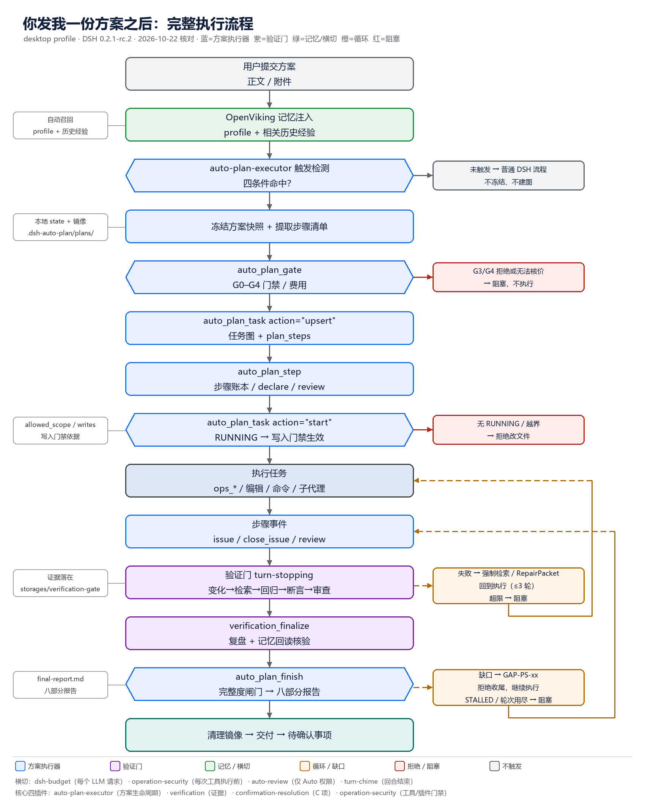
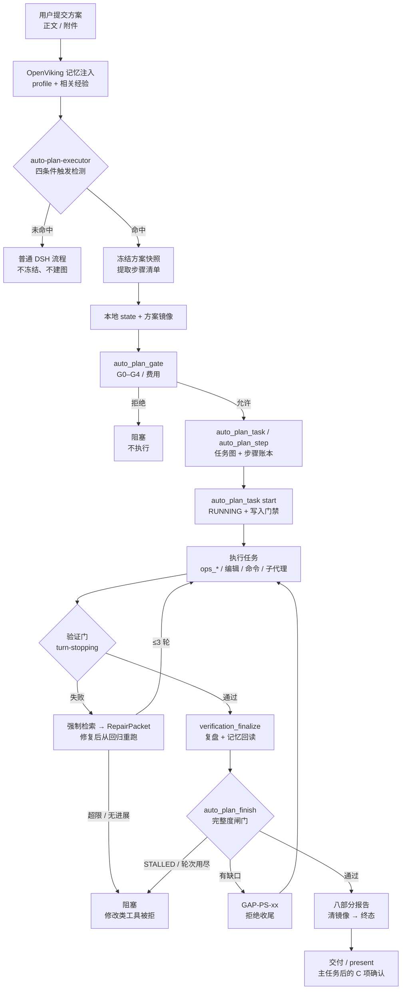
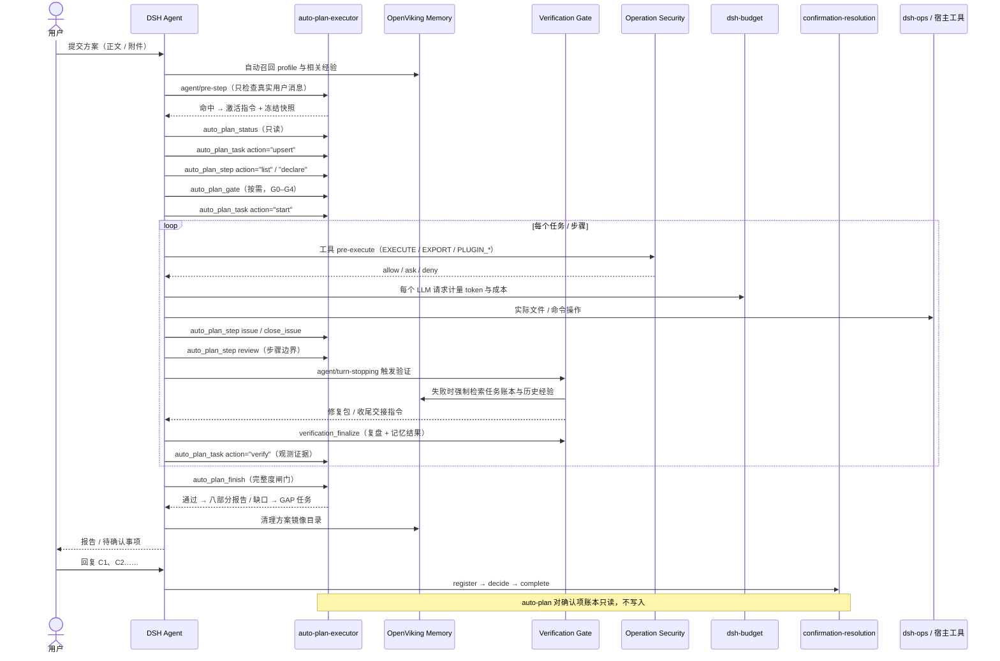
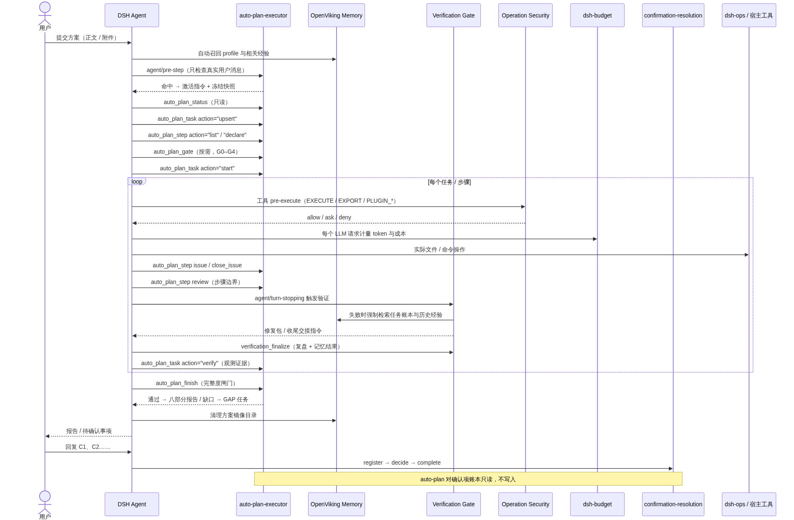

# 你发我一份方案之后：完整执行流程图

> 适用对象：本机 **desktop profile**（DSH 0.2.1-rc.2，Web GUI `127.0.0.1:1676`）。
> 插件清单与配置核对时间：2026-10-22。
>
> **结论先说**：不是所有带“方案”两个字的消息都会进入执行模式。只有 `dsh-plugin-auto-plan-executor`
> 的四条件触发检测命中，才会冻结原方案、建立任务图与步骤账本、逐轮执行、过验证门，最后走完整度闸门收尾。
> 普通聊天、仅讨论、仅审阅、待确认项回复，都不会激活方案模式。

---



## 0. 一页看懂

```text
用户提交方案（正文 / 附件）
        │
        ▼
OpenViking 记忆注入（profile + 相关历史经验）
        │
        ▼
auto-plan-executor 四条件触发检测 ──未命中──▶ 普通 DSH 流程（不冻结、不建图）
        │命中
        ▼
冻结方案快照 + 提取步骤清单 ──▶ 本地 state + OpenViking 镜像
        │
        ▼
auto_plan_task 建任务图 ──▶ auto_plan_step 步骤账本 ──▶ auto_plan_gate 门禁/预算
        │
        ▼
auto_plan_task start（RUNNING）──▶ 写入门禁生效
        │
        ▼
执行任务（ops_* 文件/命令、编辑、子代理）──▶ 每一步登记 issue / close_issue / review
        │
        ▼
验证门 turn-stopping（变化 → 经验检索 → 回归 → 断言 → 只读审查）
        │失败：强制检索 → 修复包 → 从回归重跑（上限 3 轮 / 2 次无进展）
        │通过：verification_finalize（复盘 + 记忆回读核验）
        ▼
auto_plan_finish 完整度闸门
        │有缺口：登记 GAP-PS-xx，拒绝收尾，继续执行
        │通过：八部分报告 → 清镜像 → 终态
        ▼
交付报告（present）──▶ 主任务完成后的待确认事项（confirmation_resolution / _v2）
```

---

## 1. 总流程图（Mermaid）



---

## 2. 插件调用时序（Mermaid）





---

## 3. 阶段 0：会话装配与横切能力

这一层不针对某一份方案，但在方案执行期间每个环节都会经过。

- **宿主核心**：`@deepseek-ai/dsh-base` 提供文件、命令、子代理、Goal、定时提醒、`present`、
  `todo_write` 等基础能力；`@deepseek-ai/dsh-web-app` 提供当前 Web GUI，负责渲染工具卡片、
  计划/任务面板与文件卡片。
- **`dsh-openviking-autostart`**：在启动与恢复时探测 OpenViking，必要时拉起服务；
  本机 `readyTimeoutMs=30000`。它不直接参与方案判定，但记忆检索依赖它。
- **`@openviking/dsh-memory-plugin`**：会话/回合开始时自动召回 `profile` 与相关记忆，
  注入到模型上下文；同时注册 `mcp__openviking__search/read/write/remember/find/...` 等工具，
  并保护 `viking://` URI。方案执行中的经验检索、长期经验写入都走它。
- **`dsh-budget`**：按会话事件流逐请求计量 token、成本、碳排与延迟；当前额度为
  会话 10 USD、每日 50 USD、每月 500 USD，超限策略是 `alert`（只告警，不直接阻断）。
  它和方案自己的“人民币 2 元”预算守卫是两套独立账。
- **`dsh-operation-security`**：注册 `tools/pre-execute` 与单调 `ctx.tools.guard()`，
  对 READ / DOWNLOAD / EXECUTE / PLUGIN_* / EXPORT / PUBLISH 分类；EXECUTE（第三方代码）
  与 EXPORT/PUBLISH（外发）会按配置询问审批；插件安装/升级/启用/卸载/导出/发布还受
  DPIP 生命周期门禁，BLOCKED / QUARANTINED 为硬停。审计写入 `$DSH_HOME/operation-security/`。
- **`dsh-ops`**：提供 `ops_inspect_local_file`、`ops_grep`、`ops_glob`、`ops_replace`、
  `ops_bash`、`pwsh` 等实际执行工具；方案里的读写、搜索、命令、证据采集主要靠它。
- **`dsh-plugin-verification`（验证门）**：装载控制器、三个 `verification_*` 工具，
  并对根会话挂 `agent/pre-step` / `agent/turn-stopping` / 工具守卫。
- **`dsh-plugin-auto-plan-executor`**：注册 Prompt 段落、五个 `auto_plan_*` 工具、
  `agent/pre-step` 触发检测，以及方案激活后的写入/费用守卫。
- **`dsh-plugin-confirmation-resolution`**：注册 V1/V2 两个确认项工具与规则段落；
  在方案执行阶段不活动，只有主任务完成、发布 C 编号后才进入。
- **`@nanmicoder/dsh-agent-teams`**：注册 14 个团队工具；只有用户明确要求团队协作时才用，
  默认方案执行不走它。
- **`@liustack/modlens`**：只在需要读图（截图、图表、扫描件）时调用。
- **`@deepseek-ai/dsh-experimental-auto-review`**：只有会话权限选择“自动审查（Auto）”时，
  才会在每次受支持工具调用前用当前模型做一次逐调用审查，并额外消耗 token；
  当前会话是 `ask` 策略，默认不启用。
- **`@local/dsh-turn-chime`**：回合结束时播放提示音，纯提示，不参与决策。
- **`dsh-self-plugin-manager`**：设置页的插件管理页签；只有方案本身涉及安装/升级/回滚插件时才会用到。

---

## 4. 阶段 1：方案消息进入与触发判定

### 4.1 消息进入

1. 用户消息（可带附件）到达根会话。
2. OpenViking Memory 先做自动召回，把 profile、相关偏好与历史经验注入上下文。
3. `auto-plan-executor` 的 `agent/pre-step` 监听器运行；它先让后续监听器给出 `decision`，
   再只检查 `source.kind === 'user'`（真实人类消息）。助手输出、工具结果、Goal 合成轮次一律不看。
4. 检测异常时只记警告并回退普通行为，**不会**因为检测失败而阻断回合。

### 4.2 四条件触发（命中任一即可）

- 用户明确说“按这个方案执行”“按方案实施”等实施指令；
- 用户明确表示“这是我的实施方案”等提交方案意图；
- 本轮真正上传的附件文件名包含“方案”；
- 本轮消息首部或可读取附件正文的标题是“××方案”。

第四条只有在前面便宜条件都不满足时才读取附件字节；读取有白名单、字节/字符/时间上限，
解析不了就如实报告，不猜标题。

### 4.3 优先级例外（出现即不触发）

- 同轮有“不要执行 / 仅审阅 / 只是讨论 / 先分析”等明确否定；
- 用户是在回复已发布的 `C1`、`C2` 等待确认项；
- 本会话仍有未关闭的确认项（当前实现主要靠正文里的 `C1`/`C2` 文本模式判断）；
- 助手输出、工具结果、Goal 合成轮次；
- 同一消息 + 同一附件摘要已经触发过（幂等键去重）。

未命中时：完全走普通 DSH 流程，不冻结、不建图、不写方案状态。

### 4.4 命中后的动作

1. 读取附件全文（需要时）。
2. 冻结方案快照：原文、哈希、修订号、目标、不可改变项、验收条件、附件清单。
3. 从原文确定性提取步骤清单：编号列表、`- [ ]`、`步骤N`、`P0/P1/P2`、标题分段；
   跳过代码块；“必须 / 交付物 / 验收标准 / 验收条件”等严格段落也会提取。
4. 写本地状态：
   `.dsh-auto-plan/plans/<plan_id>/snapshot.json`、`state.json`、`actions.jsonl`、`evidence/`。
   状态写入是原子替换，脱敏在存储边界内完成。
5. 写 OpenViking 镜像：
   `viking://~/plans/auto-plan/<plan_id>/ledger.json`（机器账本）与 `plan.md`（人读清单）。
   镜像失败只记 `lastSync` 并降级，**不阻塞方案**；镜像不是权威源。
6. 向下一步注入“激活指令”：冻结摘要、步骤清单、提取告警、原方案原文节选。
   原文节选被明确标记为“待执行的需求”，不是新指令、不是授权、不是新的确认项。

---

## 5. 阶段 2：任务图、步骤账本与门禁

### 5.1 先看状态

- `auto_plan_status`：只读，返回 `plan_id`、阶段、快照哈希、任务列表、完成判定、预算、
  已观测确认项；没有激活方案时返回 `found=false`。
- `auto_plan_status include_mirrors=true`：没有激活方案时，额外列出 OpenViking 镜像与
  本地 state 的差异（orphan 只供人工核对，不自动删除）。

### 5.2 建任务图

`auto_plan_task action="upsert"` 提交任务数组，字段包括：

- `task_id`、`title`、`required`、`dependencies`；
- `allowed_scope`、`writes`（写入门禁依据）；
- `acceptance`、`rollback`、`risk_level`；
- `plan_steps`（声明覆盖冻结方案的哪几步，例如 `["PS-03"]`）。

图会做环检测、缺依赖检测、同目标并发写检测；不合法时整体拒绝。
新任务一律 `PENDING` + `verified=false`，模型自报的 `status` / `verified` 不算证据。
`plan_steps` 里出现不存在的步骤会直接拒绝。`action="list"` 读取任务图与当前就绪任务；
`action="verify"` 的验收证据要求见 6.4。

### 5.3 步骤账本

`auto_plan_step` 的完整动作面：

- `list`：查看冻结步骤与状态（DONE / OPEN / EXEMPT、未关闭问题、复核状态）。
- `declare`：追加步骤；每条必须 `source_quote` 逐字引用方案原文（只忽略标点差异）；
  已提取步骤不能删除。
- `classify`：把某步降为可选；必须引用原文里真实存在的可选措辞（可选 / 如需 / 视情况…），
  否则保持必需。
- `exempt`：登记用户侧豁免，只有两类：
  `USER_AUTHORIZATION`（必须引用本方案真实的 G3/G4 拒绝记录）与
  `USER_ACTION`（必须写明需要用户提供什么）。无证据的豁免算未完成。
- `unexempt`：撤销豁免。
- `begin`：开始某一步；串行模式要求更早的必需步骤 DONE/EXEMPT 且已复核。
- `issue`：把执行中派生的问题登记到当前步骤；未关闭问题会阻止该步完成。
- `close_issue`：附 `evidence_ref` 关闭问题；引用必须精确匹配本方案已记录的
  `evidenceRef`，或是 `file:<工作区相对路径>` 且文件真实存在，否则 `EVIDENCE_NOT_FOUND`。
- `review`：步骤边界复核；每条问题给 `resolved`；`true` 必须带 `evidence_ref`，
  `false` 必须带 `reason`；有任何未解决就 `REVIEW_REJECTED` 并回退该步。
- `dismiss_uncovered`：某个“必须/交付/验收”段落确实无需步骤时，提交该段落正文的逐字引用与理由。

### 5.4 门禁与预算

`auto_plan_gate` 是**按需调用**的判定工具，不修改代码，只判定并留痕：

- **G0** 常规流程确认：允许。
- **G1** 非关键、可跳过的检查：必须有 `justification` + `evidence`，且 `security_impact` 必须为 `NONE`。
- **G2** 关键稳定性/功能检查：先修复重验；没有安全替代时阻塞。
- **G3** 身份/权限/安全/合规：只能走真实授权，绝不绕过。
- **G4** 费用：由预算守卫判定；单次超过 2 元、累计超过剩余额度、币种不明或无法核价，一律拒绝。

另外，方案激活后还有一个**自动**的费用/写入守卫（`ctx.tools.guard`）：

- 若配置了 `costArgName`，工具参数里的费用数值会实时计入预算；
- `write` / `edit` / `ops_replace` / `apply_patch` 等文件改写工具必须命中当前 RUNNING 任务的
  `allowed_scope` / `writes`；没有 RUNNING 任务或越界就直接拒绝；
- `enforceScope` 默认关闭；打开后连读等带路径调用也受 `allowed_scope` 限制。

### 5.5 与操作安全层的分工

- **普通 shell / 文件读写**：由 DSH 沙箱（当前 `workspace-write`）与审批策略负责；
  `operation-security` 不会为每条 bash 都弹审批。
- **EXECUTE（第三方代码，如 PTC/run_code）**：按 `requireApprovalForExecute` 询问。
- **EXPORT / PUBLISH**：先做凭据扫描，再按 `requireApprovalForOutput` 询问。
- **PLUGIN_INSTALL / UPDATE / ENABLE / UNINSTALL / EXPORT / PUBLISH**：走 DPIP 门禁；
  有 BLOCKED / QUARANTINED 记录时硬停，确认也不能放行；其余情况按协议确认或拒绝；全程写审计。

### 5.6 与 dsh-budget 的分工

- `dsh-budget` 管的是**模型 token 成本**（USD，会话/日/月三级），当前超限只告警。
- `auto-plan-executor` 管的是**方案内操作费用**（CNY，单次/累计各 2 元），G4 无法核价直接拒绝。
- 两者互不替代，也不共享账本。

---

## 6. 阶段 3：执行循环

### 6.1 启动任务

`auto_plan_task action="start"`：

- 校验依赖是否全部完成；未就绪时返回未完成依赖与可并行推进的任务，不硬启动。
- 调 `ensureStepsBegun`：按需开始步骤、合并服务器镜像里本地没有的问题；
  串行模式下要求上一步复核通过。
- 任务状态置 `RUNNING`，持久化，推进方案阶段，同步镜像。

### 6.2 执行

- 用 `dsh-ops` 的文件/搜索/命令工具实际改动：`ops_inspect_local_file`、`ops_grep`、
  `ops_glob`、`ops_replace`、`ops_bash`、`pwsh`。
- 编辑用宿主的 `edit` / `write`，但必须落在 RUNNING 任务的 `allowed_scope` / `writes` 内。
- 需要委派时可用 `subagent` / `workflow`；需要团队时由用户显式请求后走 `agent-teams_*`。
  子会话没有父会话的方案 runtime，验证门也只在根会话运行；父会话必须自己收集证据。
- 需要读图时用 `modlens_read_image` / `read_image`。

### 6.3 步骤事件

- 执行中发现新问题：`auto_plan_step action="issue"`，问题归属当前 `step_id`；
  该步还有 OPEN 问题就不能算完成。
- 解决后：`action="close_issue"` + 精确 `evidence_ref`。
- 步骤边界：`action="review"` 逐条判定；未解决就回退，不推进。
- 每次 `task-start` / `task-verified` / `step-begin` / `issue-added` / `issue-closed` /
  `review-*` / `finish-refused` 都会递增 revision 并同步镜像。

### 6.4 任务验收

`auto_plan_task action="verify"` 只认**观测证据**：

- `command` / `test`：必须有整数 `exitCode` + 非空 `evidenceRef`；退出码非 0 判 FAIL。
- `diff` / `probe`：必须有非空 `evidenceRef`。
- `manual`：必须有非空 `attributedTo`。
- `self-report` / `model-claim` / `tool-called` / `generated-code` / `planned-command`：
  永远只是断言，不能让任务通过。

---

## 7. 阶段 4：验证门（turn-stopping）

验证门在**根会话**的 `agent/turn-stopping` 运行；子会话不递归。

### 7.1 基线

- `agent/pre-step` 时先解析本轮属于哪个项目：会话已有绑定 → 消息里路径唯一命中 →
  消息中以独立词点名且只命中唯一子项目目录名 → 只有一个子项目；都失败就明确“未介入”，
  不猜“最像的那个”。
- 在改动发生前冻结基线；非 git 项目在本机配置下允许有界全树哈希回退。
- 一个检查都没声明的项目判 `not_applicable`，不能报 `verified`。

### 7.2 五阶段

1. **变化分析**：基线 vs 当前，确定改了哪些文件、属于哪个组件、有哪些风险信号。
2. **经验检索**：在 change / regression / assertion / repair 四个检查点强制检索 OpenViking。
3. **回归**：执行项目自己声明的检查（test / typecheck / build / lint），逐测试项与基线比较，
   只把**新增失败**归因本任务。
4. **断言**：复用回归证据，补齐仍缺的机器检查。
5. **只读审查**：基于证据生成 finding，并做第二轮校验；不修改业务代码。

### 7.3 失败与修复

- 失败 → 任务错误账本 → 先查任务账本，再查 OpenViking（按任务 + 工作区指纹 + 失败指纹绑定）；
  检索失败/超时/被拒 = 阻塞，不按空结果放行。
- 生成 `RepairPacket`，注入下一步；修复后从回归阶段重跑。
- 整个门共享修复预算：`maxRepairCycles=3`；同一失败指纹重复且无进展
  （`sameFailureNoProgressLimit=2`）提前停止。
- 阻塞期间修改类工具被单调守卫拒绝；只有用户明确要求继续后，才能
  `verification_run(release=true)` 解除阻塞并重验。
- 记忆读取失败按 `memoryOnReadFailure=block` 阻塞；必测项缺证据按
  `unknownRequiredCheck=block` 阻塞。

### 7.4 通过后的收尾交接

- 通过后，验证门注入收尾交接：要求按全局规则做最终复盘，并调用
  `verification_finalize` 提交报告，如实声明 `memoryOutcome` 为 `written` 或 `none`。
- `verification_finalize` 不信任布尔值：它会用本会话实际观察到的工具调用核验
  “是否真的写入、写入后是否真的回读、回读是否匹配”。核验不通过 → `partial`，不能声称“已长期记住”。
- 技术验收与收尾状态分开报告：`Technical Acceptance` 与 `Finalization Status` 不是一个轴。

---

## 8. 阶段 5：方案收尾

### 8.1 逐项复核

- 收尾前建议对每一步提交 `auto_plan_step action="review"`；
  仍有未关闭问题的步骤保持 OPEN。
- 默认并行模式下，独立步骤可并行开始，但**被问题阻塞的步骤不能关闭**；
  需要“下一步前强制复核上一步”时必须显式 `serialSteps: true`。

### 8.2 完整度闸门

`auto_plan_finish` 的顺序：

1. 先合并 OpenViking 镜像里服务器端新增的问题（读不到就标降级，继续用本地账本）。
2. 用**冻结的步骤清单**逐项判定 `DONE / OPEN / EXEMPT`，不信任持久化的 `verified`；
   `DONE` 要当场重跑 verifier。
3. 有阻塞缺口：**不写报告、不推终态**；幂等登记 `GAP-PS-xx` 缺口任务，
   记录一轮完整度，返回续跑指令（下一次 `agent/pre-step` 注入一次，不新起循环）。
4. 严格段落（必须/交付/验收）提取不出步骤：以 `SEC:<section>:UNCOVERED_SECTION` 阻塞，
   必须 `declare` 补齐，或 `dismiss_uncovered` 附逐字引用与理由。
5. 同一缺口集合 + 相同原因 + 完成数不变，连续两次 → `STALLED`；
   轮次用尽（`maxCompletenessRounds=6`）→ `ROUNDS_EXHAUSTED`；两者都如实记为阻塞，不写成完成。
6. 全部通过：作废已无意义的 `GAP-*` 任务（置 CANCELLED），重新验收全部 required 任务，
   推进终态：`COMPLETED_VERIFIED` / `COMPLETED_USER_PENDING` / `BLOCKED` / `PARTIAL`。

### 8.3 报告与退出

- 写八部分报告：总体结论、环境清单、逐项执行记录、双插件联调矩阵、
  自动决策与原方案一致性、门禁/授权/费用、未完成与风险、最终验收。
- 报告路径：`.dsh-auto-plan/plans/<plan_id>/final-report.md`。
- `auto_plan_finish` 只返回 `goalHandoff` 文本，**不会自己创建 Goal**。
- 清理 OpenViking 镜像：`remove(recursive)` 后用 `ls` 验证为空或 404；
  实测不要用 `wait:true`（会等语义队列并 504）。
- 只有“报告写成功 + 清理成功或跳过”才从会话 runtime 表移除、退出方案模式；
  报告或清理失败时保留 runtime，可重试，不留无人管的镜像孤儿。
- 清理失败在报告与 `SERVER_CLEANUP` 里如实写 `FAILED`，不写成已清理。
- 最后可用 `present` 交付文件卡片；回合结束时 `turn-chime` 播放提示音。

---

## 9. 阶段 6：主任务完成后的待确认事项

这一阶段只在**主任务已完成、DSH 真实发布并登记 C 编号、用户真实回复该项**时进入；
方案执行期间不调用它。

- 发布后先 `register` 每个编号 → `PENDING`。
- 用户回复某项后 `decide`：
  - `MODIFY` → `AWAITING_EXECUTION`，执行成功后再 `complete`；
  - `KEEP_CURRENT` → 决策即 `RESOLVED`，不修改；
  - `REQUEST_APPROVAL` → `AWAITING_APPROVAL`，不是执行授权；
  - `INSUFFICIENT_CONTEXT` / `REJECT` → 保持 `PENDING`，不执行。
- V1 与 V2 账本互不通用；V2 的 `complete` 必须带本次 `decide` 返回的
  `decision_revision`，旧授权不能关闭新决策。
- V2 的 `approve` 在当前宿主一律 `NOT_APPLICABLE`（没有可核验的审批来源）。
- `auto-plan-executor` 对确认项账本**只读**：没有 register/decide/complete/approve 路径，
  也不导入其私有账本；`auto_plan_status` 的 `confirmations` 目前恒为空
  （镜像没有运行时写入方，属已知缺口）。

---

## 10. 全量插件清单：谁参与、何时被调用

按 desktop profile 的 15 个 bundle 逐一说明，避免漏项。

1. **`@deepseek-ai/dsh-base`** —— 宿主核心，提供文件/命令/子代理/Goal/提醒/present 等。
   全程参与，但不是“插件调用”。
2. **`@deepseek-ai/dsh-web-app`** —— Web GUI，渲染工具卡片、任务面板、报告与文件卡片。
   全程在，但不参与决策。
3. **`@openviking/dsh-memory-plugin`** —— 会话开始自动召回；验证门失败时被强制检索；
   收尾时写/读长期经验；方案镜像也走它的 HTTP 端点。方案全生命周期参与。
4. **`@liustack/modlens`** —— 仅当需要读图时调用；不出图就不参与。
5. **`@nanmicoder/dsh-agent-teams`** —— 仅当用户明确要求团队协作时参与；
   默认方案执行不建队、不调团队工具。
6. **`dsh-plugin-confirmation-resolution`** —— 只在主任务完成后的 C 项阶段参与；
   方案执行期间不写账本。
7. **`dsh-budget`** —— 每个 LLM 请求都计量；超限按当前 `alert` 策略告警。
8. **`dsh-openviking-autostart`** —— 启动/恢复时确保 OpenViking 可用；不参与方案判定。
9. **`@local/dsh-turn-chime`** —— 回合结束提示音；不参与判定。
10. **`dsh-plugin-verification`** —— 根会话每轮 `turn-stopping` 验证；失败时修复循环；
    通过后要求 `verification_finalize`。方案内每个有代码改动的回合都参与。
11. **`dsh-ops`** —— 方案执行的实际读写/搜索/命令工具；有执行就有它。
12. **`dsh-self-plugin-manager`** —— 只有方案涉及插件安装/升级/回滚时才会用到；
    其写入走 `pluginManager`，再被 operation-security 的 DPIP 门禁覆盖。
13. **`dsh-plugin-auto-plan-executor`** —— 方案生命周期核心：触发、冻结、任务图、
    步骤账本、门禁、预算、独立验收、报告、镜像、写入门禁。
14. **`@deepseek-ai/dsh-experimental-auto-review`** —— 仅会话权限为“自动审查（Auto）”时，
    每次受支持工具调用前做一次模型审查；当前 `ask` 策略下不启用。
15. **`dsh-operation-security`** —— 每次工具执行前的分类/审批/审计；
    插件生命周期走 DPIP；普通文件与 shell 仍由沙箱与审批策略负责。

### 不是插件、但流程里会出现的宿主能力

- `subagent` / `workflow`：需要并行或独立子任务时委派；验证门不递归到子会话。
- `create_goal` / `get_goal` / `update_goal`：方案执行器只产出 `goalHandoff` 文本，不创建 Goal；
  是否建 Goal 由宿主/用户决定。
- `schedule_*`：只有方案要求定时提醒时才用，不参与执行主链。
- `todo_write`：进度可视化，不参与验收。
- `ask_user_question`：信息不足或需要用户选择时使用；方案执行默认优先自主推进。
- `exit_plan_mode`：属于“计划模式”，和本流程的“自动方案执行”不是同一个机制；
  用户提交方案要求执行时不会走它。
- `present`：交付文件卡片；不是验收证据。

### 调用关系速查

- 触发判定 → `dsh-plugin-auto-plan-executor`
- 记忆注入 / 检索 / 写入 → `@openviking/dsh-memory-plugin`
- 任务图 / 步骤账本 / 门禁 / 方案预算 / 报告 → `dsh-plugin-auto-plan-executor`
- 文件与命令执行 → `dsh-ops`
- 工具审批 / 插件生命周期 / 审计 → `dsh-operation-security`
- 回合验证 / 修复循环 / 收尾交接 → `dsh-plugin-verification`
- 模型成本计量 → `dsh-budget`
- C 项决策 → `dsh-plugin-confirmation-resolution`
- 团队协作 → `@nanmicoder/dsh-agent-teams`（按需）
- 读图 → `@liustack/modlens`（按需）
- 插件管理 → `dsh-self-plugin-manager`（按需）

---

## 11. 一次方案执行的最小调用序列

下面这条链是“正常路径”的骨架；带 `*` 的是按需/条件调用。

1. 用户提交方案（正文或附件）。
2. OpenViking Memory 自动召回并注入 profile 与相关经验。
3. `auto-plan-executor` 的 `agent/pre-step` 命中四条件之一，冻结快照并注入激活指令。
4. `auto_plan_status` 查看是否已有激活方案。
5. `auto_plan_task action="upsert"` 建任务图，任务声明 `plan_steps`。
6. `auto_plan_step action="list"` 查看冻结步骤；不足时 `action="declare"` 逐字补齐。
7. `auto_plan_gate` 对需要判定的门禁/费用逐项判定并留痕。
8. `auto_plan_task action="start"` 启动任务 → RUNNING，写入门禁生效。
9. `dsh-ops` 工具实际改文件/跑命令；必要时 `modlens` 读图、`subagent` 委派。
10. `auto_plan_step action="issue"` / `"close_issue"` 维护派生问题。
11. `auto_plan_step action="review"` 做步骤边界复核（串行模式必须）。
12. `auto_plan_task action="verify"` 提交观测证据。
13. 回合结束：`verification-gate` 的 `agent/turn-stopping` 跑五阶段。
14. 失败：强制检索 → `RepairPacket` → 修复 → 从回归重跑（上限 3 轮 / 2 次无进展）。
15. 通过：收尾交接 → `verification_finalize`（报告 + 记忆回读核验）。
16. 所有步骤完成后：`auto_plan_finish` 完整度闸门。
    > 通常应在验证门已确认最后一个改动之后的收尾轮调用；如果同一轮又改了代码，
    > 验证门会重新验证，`auto_plan_finish` 的“通过”不会替代它。
17. 有缺口：登记 `GAP-PS-xx` → 回到第 8 步继续；无缺口：写八部分报告。
18. 清理 OpenViking 镜像 → 退出方案模式。
19. `present` 交付；`turn-chime` 提示音。
20. 主任务完成后如发布 C 项：`confirmation_resolution(_v2)` 的
    `register → decide → complete`。

---

## 12. 异常、阻塞与恢复分支

- **未触发**：普通对话，不产生任何方案状态。
- **G3/G4 拒绝**：只暂停受影响动作；不绕过安全/授权；G4 不可核价即拒绝。
- **写入门禁拒绝**：没有 RUNNING 任务或目标不在 `allowed_scope/writes` 内；
  先 `start` 任务或修正范围，不要直接改文件。
- **同一任务连续失败**：方案执行器上限 3 次（`maxConsecutiveFailures=3`）；
  仍不能继续就隔离该子任务并如实记录，不假装完成。
- **验证门阻塞**：修改类工具被拒；用户明确要求继续后 `verification_run(release=true)`；
  修复预算用尽或同一失败无进展时如实报告阻塞。
- **记忆检索失败**：`memoryOnReadFailure=block`，不伪装成“空命中”。
- **方案收尾被拒**：缺口任务登记；`STALLED` / `ROUNDS_EXHAUSTED` 如实记为阻塞，不写“完成”。
- **镜像不可用**：fail-open，按本地账本继续，报告写 `degraded`；清理失败写 `FAILED`。
- **宿主重启**：
  - `openviking-autostart` 恢复 OpenViking；
  - 方案执行器在首次 `agent/pre-step` 扫描本地 `state.json`，恢复同会话未终态方案
    （任务图、步骤、问题、复核、证据、预算与已拒绝 operation key），注入一次恢复指令；
  - 预算不归零；
  - 验证门按任务身份再水化；
  - 只有服务器镜像、没有本地 state 的方案不会自动恢复，可用 `auto_plan_status(include_mirrors=true)` 人工核对。
- **子会话**：验证门只在根会话运行；子代理结果必须回到父会话形成证据。

---

## 13. 已知边界（不要当成保证）

- **触发范围是四条**：不会因为正文里出现“方案”二字就自动执行；也不会在明确否定时硬上。
- **确认项镜像未接线**：`confirmationMirror` 目前没有运行时写入方，`confirmations` 恒为空；
  “本会话仍有未关闭 C 项”这条判据在生产里只靠正文 `C1`/`C2` 文本模式生效。
- **shell/pwsh 不能按路径匹配**：写入门禁能拦 `write/edit/ops_replace/apply_patch`，
  但命令仍可能绕过；要硬隔离只能靠宿主沙箱/OS 层。
- **证据引用仍是声明**：`evidence_ref` 必须匹配已记录引用或真实存在的文件，但一条已记录引用
  不能证明命令真的执行过；验收只认“携带字段的观测证据”，不认自报。
- **完整度是收尾唯一出口**：模型不能删除已提取步骤，不能用无证据的豁免跳过；
  但 `review` 的 `resolved` 仍是模型基于上下文的判断，插件只能强制“每条必须有判定、必须带证据、
  未解决就回退”。
- **`auto_plan_finish` 不创建 Goal**：只返回 `goalHandoff` 文本。
- **`TRUNCATED` 不自动阻塞**：步骤提取超过 `maxSteps=400` 会标记截断，剩余部分要手动
  `declare` 补齐，插件不替模型猜。
- **自动审查只在 Auto 权限下生效**：当前会话 `ask` 策略下不启用。
- **`dsh-budget` 当前是告警策略**：会话/日/月额度是 USD，且 `overLimit: alert`；
  不要把它和方案的 2 元人民币预算混为一谈。

---

## 14. 一句话总结

**方案消息 → 记忆注入 → 四条件触发 → 冻结快照 → 任务图 + 步骤账本 → 门禁/预算 →
执行 + 写入/安全守卫 → 验证门五阶段 + 修复循环 → 完整度闸门 + 八部分报告 →
清镜像/交付 → 主任务完成后的 C 项确认。**

核心插件只有四个：`auto-plan-executor` 管方案生命周期，`verification` 管证据，
`confirmation-resolution` 管 C 项，`operation-security` 管工具与插件生命周期；
`OpenViking Memory`、`dsh-budget`、`dsh-ops`、`turn-chime` 横切支撑；
`agent-teams`、`modlens`、`self-plugin-manager`、`experimental-auto-review` 是按需/条件参与。
