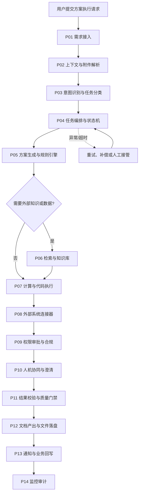
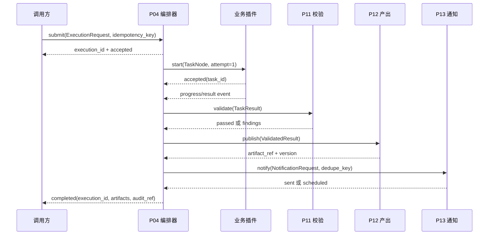

# 方案执行插件改造完整方案

> 文档版本：v1.0（基线方案）  
> 编制日期：2026-10-23  
> 适用范围：方案接收、拆解、执行、校验、产出和通知的插件化流程

## 0. 阅读说明与边界

上一轮提到的三个参考文件（完整流程图、插件调用时序图、完整流程图 Markdown）在当前执行工作区中没有可读取副本。因此，本文件不把未知的原始插件名称、字段名或实现细节冒充为既定事实，而是按“方案执行”所需的功能职责建立一套可直接落地的改造基线。

落地时应将上一轮图中的实际插件名称映射到本方案的 `P01-P15`。只要职责相同，就沿用本方案的接口和状态契约；若原图存在额外插件，则按“一个职责一个插件”的原则补充到插件注册表，并遵循本方案的幂等、权限、审计和错误规范。

本方案解决的是：

- 用户提交一个方案执行请求后，系统如何识别任务、拆解步骤、调用插件并汇总结果；
- 每个插件需要改什么，改动涉及接口、输入输出、状态、重试、权限、审计和验收；
- 如何保证长流程可恢复、可观察、可回放，且不会因重复回调造成重复写入或重复通知；
- 如何在不一次性切换全部流量的情况下完成迁移和上线。

本方案不假设某个具体业务域、数据库或第三方平台。业务插件应把领域规则实现放在各自插件内部，把通用执行协议保持一致。

---

## 1. 建设目标

### 1.1 业务目标

1. 将“方案执行”从一次性串行调用改造成可恢复的任务图执行。
2. 让每一步都有明确的输入、输出、负责人插件、超时和验收条件。
3. 允许人工澄清、人工审批和人工接管插入流程，而不需要重跑整个方案。
4. 让最终产物可追溯到原始请求、上下文版本、每个节点的输入输出和审批记录。
5. 在插件失败、网络抖动或调用方重复提交时，保证结果一致、写入不重复、通知不重复。

### 1.2 技术目标

- 统一执行请求 `ExecutionRequest`、节点任务 `TaskNode`、事件 `ExecutionEvent`、结果 `TaskResult` 和错误 `PluginError`；
- 采用“编排器负责流程，插件负责能力”的边界；
- 所有外部副作用走幂等键和提交确认；
- 所有插件支持健康检查、能力声明、版本和兼容范围；
- 通过结构化日志、指标、链路追踪和审计事件实现端到端定位；
- 支持灰度、回滚和旧版插件兼容。

### 1.3 非目标

- 不在编排器中复制每个业务插件的领域逻辑；
- 不让插件之间直接互相调用并形成隐藏环路；
- 不用自然语言文本作为唯一的机器间契约；
- 不把“成功返回 HTTP 200”当作业务成功，必须区分已接受、执行中、已提交和已验证。

---

## 2. 目标流程

### 2.1 端到端流程



上图表达的是职责关系，不要求每次执行都经过所有节点。编排器根据方案图和插件能力动态选择节点；例如纯计算任务可以跳过 P06，纯文档整理任务可以跳过 P08。

### 2.2 调用时序



### 2.3 核心原则

1. **编排器单写状态**：只有 P04 能推进执行状态；其他插件通过事件返回结果。
2. **插件无隐藏副作用**：插件必须声明哪些操作会写外部系统，且每个副作用绑定幂等键。
3. **事件至少一次投递，业务结果恰好一次提交**：消息可以重复到达，业务提交必须去重。
4. **失败是状态，不是异常文本**：失败原因、可重试性、补偿动作和人工处理建议必须结构化。
5. **人工节点可暂停**：等待用户补充信息或审批时，执行进入 `WAITING_*`，不占用工作线程。

---

## 3. 插件总清单与改造范围

| 编号 | 插件职责 | 主要改造 | 是否有外部副作用 | 默认超时 |
|---|---|---|---:|---:|
| P01 | 需求接入 | 统一请求协议、幂等、鉴权、限流 | 否 | 5 秒 |
| P02 | 上下文与附件解析 | 文件解析、版本快照、敏感信息标记 | 读文件 | 60 秒 |
| P03 | 意图识别与任务分类 | 分类置信度、澄清阈值、能力路由 | 否 | 20 秒 |
| P04 | 任务编排与状态机 | DAG、依赖、重试、恢复、补偿 | 写执行状态 | 30 秒/节点 |
| P05 | 方案生成与规则引擎 | 模板、规则版本、变量校验 | 否 | 60 秒 |
| P06 | 检索与知识库 | 检索范围、证据链、时效和引用 | 读数据 | 30 秒 |
| P07 | 计算与代码执行 | 沙盒、资源限制、结果快照 | 可写临时空间 | 120 秒 |
| P08 | 外部系统连接器 | 连接管理、读写分离、幂等提交 | 是 | 60 秒 |
| P09 | 权限审批与合规 | 权限决策、审批单、策略版本 | 写审批记录 | 30 秒 |
| P10 | 人机协同与澄清 | 问题生成、等待、恢复、接管 | 可发起交互 | 24 小时 |
| P11 | 结果校验与质量门禁 | Schema、规则、引用、风险门禁 | 否 | 60 秒 |
| P12 | 文档产出与文件落盘 | 产物版本、原子写入、可下载引用 | 是 | 120 秒 |
| P13 | 通知与业务回写 | 模板、去重、失败补偿、渠道策略 | 是 | 30 秒 |
| P14 | 监控与审计 | 指标、追踪、审计、回放 | 写日志/审计 | 10 秒 |
| P15 | 插件注册与配置中心 | 能力目录、版本、灰度和密钥引用 | 写配置 | 10 秒 |

---

## 4. 每个插件的具体改造方案

以下各节均按“职责、必须改动、接口、数据、异常、验收”描述。实现时每一节至少形成一个开发任务、一个契约测试任务和一个上线检查项。

### 4.1 P01 需求接入插件

#### 职责

接收用户或上游系统提交的方案执行请求，完成鉴权、参数初验、幂等判断和执行单创建。P01 不负责拆解任务，也不直接调用业务插件。

#### 必须改动

1. 将现有自由文本入口统一包装为 `ExecutionRequest`。
2. 增加 `request_id`、`tenant_id`、`actor_id`、`idempotency_key`、`source` 和 `schema_version`。
3. 对同一租户的重复 `idempotency_key` 返回第一次的 `execution_id`，不得创建第二个执行单。
4. 增加请求大小、频率和并发限制；限制命中时返回结构化错误，不返回内部堆栈。
5. 将鉴权结果作为签名后的 `ActorContext` 传给 P04，禁止下游插件自行猜测用户身份。
6. 对附件只传引用和元数据，不在请求体中重复嵌入大文件。

#### 接口调整

```json
{
  "schema_version": "1.0",
  "request_id": "req_01",
  "tenant_id": "tenant_01",
  "actor_id": "user_01",
  "source": "chat",
  "idempotency_key": "tenant_01:client_key_123",
  "objective": "执行用户提交的方案",
  "constraints": {"deadline": null, "approval_required": true},
  "attachments": [{"file_ref": "file_01", "name": "input.md", "media_type": "text/markdown"}],
  "callback": {"mode": "poll", "url": null}
}
```

同步返回：`202 Accepted`、`execution_id`、`status=ACCEPTED`、状态查询地址。重复请求返回同一执行单，并增加 `deduplicated=true`。

#### 异常与验收

- 无效身份、租户不匹配、请求字段缺失、超限分别使用不同错误码；
- 相同幂等键并发提交 100 次只能产生一个执行单；
- 请求日志不得记录原始密钥、完整附件内容或敏感字段；
- 上游收到 `202` 后，即使 P04 短暂不可用，也能通过重试或队列最终接收。

### 4.2 P02 上下文与附件解析插件

#### 职责

读取请求中的文件和历史上下文，生成可供后续插件消费的标准化上下文快照。P02 只做解析、归一化和标记，不改变原始文件。

#### 必须改动

1. 为每个执行单建立不可变的 `ContextSnapshot`，包含来源、版本、哈希和生成时间。
2. 支持 Markdown、纯文本、JSON、CSV 和常见图片/扫描件的文本抽取；无法解析时返回 `UNSUPPORTED_FORMAT`。
3. 对解析后的片段保留 `source_ref`、页码或行号，供 P06、P11 和 P12 引用。
4. 增加敏感信息识别标记，例如个人身份信息、密钥、财务字段；只标记，不擅自删除业务必需内容。
5. 对重复附件按内容哈希去重，但保留请求中的逻辑引用。
6. 大文件使用分块和异步任务；P04 不应被解析过程阻塞。

#### 输出契约

```json
{
  "context_snapshot_id": "ctx_01",
  "source_versions": [{"ref": "file_01", "sha256": "...", "version": 3}],
  "segments": [{"segment_id": "seg_01", "text": "...", "source_ref": "file_01", "location": "L10-L22"}],
  "sensitivity": [{"segment_id": "seg_02", "labels": ["secret"]}],
  "parse_warnings": []
}
```

#### 异常与验收

- 原始文件不可变且可按哈希复核；
- 同一文件重复提交不会产生两份解析内容；
- 解析失败能定位到具体文件和原因；
- P02 超时后，P04 能暂停在 `WAITING_CONTEXT`，而不是把空上下文当成成功。

### 4.3 P03 意图识别与任务分类插件

#### 职责

把用户目标归类为一个或多个执行类型，并输出需要的能力、优先级、风险级别和澄清问题候选。

#### 必须改动

1. 输出分类结果、置信度、依据片段和候选备选类，不能只返回一个字符串。
2. 增加置信度阈值：低于阈值时转 P10 生成澄清问题，不得直接进入高风险外部写入。
3. 将“只读、计算、生成文档、外部写入、通知”标记为独立能力维度。
4. 将分类模型或规则版本写入结果，保证后续可回放。
5. 支持多意图任务，返回依赖关系而不是强行合并成一个标签。

#### 结果示例

```json
{
  "intent_version": "intent-2026-10",
  "labels": [{"name": "plan_execution", "confidence": 0.94}],
  "required_capabilities": ["retrieve", "compute", "publish"],
  "risk_level": "medium",
  "clarification_required": false,
  "evidence": [{"segment_id": "seg_01", "reason": "明确提出执行目标"}]
}
```

#### 异常与验收

- 置信度低于配置阈值时不会越过 P09；
- 同一上下文和同一版本可重复得到可解释的分类结果；
- 分类插件不可用时，P04 使用安全的只读降级模板，不执行外部写入。

### 4.4 P04 任务编排与状态机插件

#### 职责

负责生成和执行任务图、保存唯一状态、调度插件、处理重试、补偿、暂停、恢复和人工接管。P04 是全链路的状态权威。

#### 必须改动

1. 从线性脚本改为 DAG 或状态机，节点包含 `node_id`、`depends_on`、`plugin_id`、`input_ref`、`timeout`、`retry_policy` 和 `side_effect_level`。
2. 每个节点每次执行都分配 `attempt` 和 `attempt_id`；重试不能覆盖上一次尝试记录。
3. 支持并行分支、汇聚节点、条件节点和人工等待节点。
4. 增加恢复扫描器：扫描 `RUNNING` 超过租约的节点，先确认是否已有提交，再决定重试。
5. 将插件结果写入不可变事件，再由投影器更新当前状态，避免“状态已改但结果丢失”。
6. 将重试策略配置化：仅对 `retryable=true` 且未产生不可逆副作用的错误自动重试。
7. 外部写入节点必须有补偿策略或明确标记为不可补偿，进入 P09 审批。

#### 核心状态

`ACCEPTED -> PREPARING -> RUNNING -> WAITING_INPUT/WAITING_APPROVAL -> VALIDATING -> PUBLISHING -> COMPLETED`。

异常分支：`RUNNING -> RETRYING -> RUNNING`、`RUNNING -> COMPENSATING -> FAILED`、任意可暂停状态 `-> CANCELLED`。终态只能是 `COMPLETED`、`FAILED`、`CANCELLED` 或 `EXPIRED`。

#### 调度接口

```json
{
  "execution_id": "exec_01",
  "node_id": "node_08",
  "attempt_id": "attempt_08_1",
  "plugin_id": "P08",
  "plugin_version": "2.3.0",
  "input_ref": "event://ctx_01/result_07",
  "deadline_at": "2026-10-23T20:00:00Z",
  "idempotency_key": "exec_01:node_08",
  "trace_id": "trace_01"
}
```

#### 验收

- 进程重启后可从事件日志恢复，不重复提交已确认的外部写入；
- 任意节点都能查询当前状态、最后一次错误、全部尝试和输入输出引用；
- 并行节点全部成功才允许汇聚节点运行；
- 一个节点失败不会吞掉同批其他节点的结果；
- 取消请求能阻止尚未开始的节点，并对正在运行的节点发出取消信号。

### 4.5 P05 方案生成与规则引擎插件

#### 职责

根据目标、上下文、分类结果和模板生成可执行方案图、变量清单和规则决策。

#### 必须改动

1. 将模板、规则和提示词从代码中抽离，均带版本号和生效范围。
2. 输出结构化任务图，不允许只生成自然语言步骤。
3. 对每个节点声明输入来源、输出 Schema、权限等级、超时和失败处理。
4. 在生成后做静态校验：无环、无孤立节点、依赖存在、能力已注册、写入节点有审批要求。
5. 支持方案预览和锁定；锁定后只允许通过变更版本更新，不原地覆盖。
6. 记录生成依据和变量解析结果，便于 P11 审查和回放。

#### 方案图最小结构

```json
{
  "plan_id": "plan_01",
  "plan_version": 4,
  "nodes": [{
    "node_id": "node_01",
    "plugin_id": "P06",
    "depends_on": [],
    "input_schema": "retrieval.input.v1",
    "output_schema": "retrieval.output.v1",
    "side_effect_level": "read",
    "retry_policy": {"max_attempts": 2, "backoff_seconds": 5}
  }],
  "approval_points": ["node_08"]
}
```

#### 验收

- 规则版本可追溯；
- 无法满足能力或权限时在生成阶段失败，而不是运行到一半才失败；
- 方案图通过静态校验后才可提交给 P04。

### 4.6 P06 检索与知识库插件

#### 职责

在授权范围内检索知识、历史记录或外部资料，返回带证据定位的结果。

#### 必须改动

1. 将检索范围、租户、数据新鲜度和最大结果数显式化。
2. 每条结果带 `source_ref`、来源版本、更新时间、匹配原因和权限标签。
3. 将“没有找到”与“无权限访问”分开；禁止把权限错误伪装成空结果。
4. 支持关键词、结构化过滤和向量检索的组合，但统一输出格式。
5. 对外部实时数据记录查询时间和数据时效；过期数据必须标记。
6. 对结果做敏感字段过滤或降级，且保留“被过滤”的审计事件。

#### 验收

- 结果可以被 P11 逐条引用和复核；
- 同一检索快照可重放；
- 越权查询在插件边界被拒绝；
- 检索超时不会导致 P05 或 P04 把空结果视为有效依据。

### 4.7 P07 计算与代码执行插件

#### 职责

执行受控计算、转换、校验和数据处理，输出结果文件或结构化值。

#### 必须改动

1. 所有代码在隔离沙盒中运行，限制 CPU、内存、磁盘、网络和最长执行时间。
2. 默认关闭外网和宿主机文件访问；需要网络时由 P09 授权具体域名和方法。
3. 固化运行时版本、依赖清单、输入文件哈希和随机种子。
4. 标准化 stdout、stderr、退出码和产物清单；日志大小设上限。
5. 结果写入临时空间后由 P11 校验，再由 P12 进行正式落盘。
6. 对同一 `execution_id + node_id` 使用幂等产物目录，避免重试污染结果。

#### 验收

- 资源超限能被识别为 `RESOURCE_EXHAUSTED`；
- 沙盒无法访问未授权文件和网络；
- 相同输入、版本和种子可以重现同一结果或明确记录非确定性来源；
- 计算失败不会把半成品标记为正式产物。

### 4.8 P08 外部系统连接器插件

#### 职责

统一访问业务系统、第三方 API 或数据库，隔离连接认证、限流、重试和幂等提交。

#### 必须改动

1. 为每个外部系统提供独立适配器，统一暴露 `read`、`prepare_write`、`commit_write`、`query_status` 和 `cancel`（若支持）接口。
2. 凭据只通过密钥引用传入，插件日志中不得输出令牌、Cookie 或完整请求体。
3. 读请求和写请求分开声明权限、超时和重试策略。
4. 写操作必须先生成外部幂等键；如果目标系统不支持幂等键，插件必须在本地维护提交记录并在重试前查询状态。
5. 区分网络超时、对方拒绝、业务校验失败和“状态未知”。状态未知时先查询，不得直接重写。
6. 对外部系统的字段映射、版本和兼容性写入连接器配置，不散落在编排器。

#### 验收

- 网络抖动和重复回调不会产生重复业务记录；
- 状态未知可以通过 `query_status` 收敛；
- 每个外部写入都能关联到审批记录、执行单和审计事件；
- 更换一个外部系统只需替换对应适配器，不修改 P04 状态机。

### 4.9 P09 权限审批与合规插件

#### 职责

在方案运行前和高风险节点前做权限判断、审批编排、策略检查和合规留痕。

#### 必须改动

1. 将权限判断拆成主体、资源、动作、范围、条件和策略版本。
2. 对只读、内部写入、外部写入、批量写入和通知分别定义风险等级。
3. 审批单包含执行单、节点、拟执行动作、影响范围、数据摘要、过期时间和审批人。
4. 审批结果不可被插件自行覆盖；变更权限或目标后必须重新审批。
5. 策略结果返回 `ALLOW`、`DENY`、`REQUIRE_APPROVAL` 或 `REQUIRE_REDACTION`，并附原因码。
6. 审批等待期间，P04 进入 `WAITING_APPROVAL`，不重复创建审批单。

#### 验收

- 越权动作在外部系统调用前被拦截；
- 审批过期、审批人变更、目标资源变更都会重新计算；
- 审批结果可审计、可回放，且不能由自然语言上下文替代。

### 4.10 P10 人机协同与澄清插件

#### 职责

把低置信度、缺少关键参数或需人工判断的问题转成可回答的交互任务，并在答案返回后恢复原执行图。

#### 必须改动

1. 每次只询问阻塞后续执行的最小问题，标记问题来源和影响节点。
2. 给出结构化选项、默认值、截止时间和“拒绝/跳过”路径。
3. 将问题、用户回答、回答时间和上下文版本保存为不可变记录。
4. 支持人工接管：接管后暂停自动重试，并记录接管人和处理说明。
5. 回答返回后只重算受影响节点，不重跑已确认的只读步骤。
6. 超时后按方案配置选择失败、跳过或升级，不默认无限等待。

#### 验收

- 同一个问题不会因事件重复而重复发送；
- 回答能精确恢复到原节点；
- 用户拒绝提供信息时，流程进入明确的 `CANCELLED_BY_USER` 或安全降级分支。

### 4.11 P11 结果校验与质量门禁插件

#### 职责

校验节点输出是否符合 Schema、业务规则、证据要求、权限约束和风险门槛，决定是否允许发布。

#### 必须改动

1. 分层校验：结构校验、字段校验、业务规则、引用完整性、敏感信息和风险策略。
2. 每条问题带严重级别、位置、规则版本、修复建议和是否阻断。
3. 支持机器自动修复后再次校验，但必须保留修复前后的差异。
4. 引用型结果必须能回指 P02 的来源片段或 P06 的检索记录。
5. 质量门禁输出明确的 `PASS`、`PASS_WITH_WARNINGS` 或 `BLOCK`。
6. P11 不直接发布、不直接通知；只把决策返回给 P04。

#### 验收

- 缺少必需字段、越权数据、无来源结论和高风险错误会阻断发布；
- 警告不会被误标成通过；
- 校验规则版本与执行单绑定，可重放。

### 4.12 P12 文档产出与文件落盘插件

#### 职责

把通过质量门禁的结果生成 Markdown、HTML、PDF、表格或其他约定产物，进行版本化、原子写入并返回稳定引用。

#### 必须改动

1. 产物采用临时文件、哈希校验、原子提交三步流程；未完成的文件不得暴露为正式版本。
2. 每个产物记录 `artifact_id`、`execution_id`、`source_result_refs`、生成器版本、媒体类型和大小。
3. 支持同一执行单生成多个产物，并明确主产物和辅助产物。
4. 输出文件名不能来自未经清洗的用户输入；清理路径穿越和控制字符。
5. 允许生成新文件和替换同一文件的显式版本，但禁止无审计的覆盖。
6. 产物引用使用稳定的 `artifact_ref`，下游不要依赖本地临时路径。

#### 验收

- 生成中断不会留下可见半成品；
- 产物可以根据执行单和版本回溯；
- 重新执行同一版本时，能区分“相同内容的新版本”和“重复提交”。

### 4.13 P13 通知与业务回写插件

#### 职责

将执行结果按渠道、收件人和模板发送，并把必要状态回写到业务系统。

#### 必须改动

1. 通知请求拆分为收件人解析、模板渲染、渠道发送和发送结果确认。
2. 使用 `execution_id + notification_type + recipient + artifact_version` 作为默认去重维度。
3. 模板版本化，敏感信息按渠道和收件人权限脱敏。
4. 渠道失败按错误类型重试；不可达、拒收和内容违规必须进入人工处理队列。
5. 业务回写与通知发送解耦；一个失败不应隐式回滚另一个已成功的操作。
6. 支持“仅生成草稿、不发送”和“发送后可追踪”的模式。

#### 验收

- 重复事件只发送一次；
- 发送结果能查询到渠道响应、时间和模板版本；
- 收件人不明确时交给 P10，不静默猜人；
- 发送失败有补偿或明确的待处理状态。

### 4.14 P14 监控与审计插件

#### 职责

记录执行链路、插件调用、状态变化、权限决策、文件产物、人工操作和外部副作用，提供指标、告警和回放依据。

#### 必须改动

1. 统一 `trace_id`、`span_id`、`execution_id`、`node_id`、`attempt_id` 和 `plugin_id`。
2. 结构化日志和审计事件分开：日志可采样，审计事件不可静默丢弃。
3. 增加核心指标：执行成功率、节点重试率、P50/P95/P99 时延、等待输入时长、审批时长、外部写入重复率、通知去重率、产物生成失败率。
4. 对敏感字段做脱敏或哈希；为审计查询提供按执行单、用户、插件和时间范围过滤。
5. 保存事件 Schema 和版本，支持按事件重建执行状态。
6. 对异常积压、租约超时、未知状态、审批过期和队列延迟设置告警。

#### 验收

- 从一个 `execution_id` 可以定位到所有节点和外部副作用；
- 审计记录能证明“谁在何时以什么版本批准了什么动作”；
- 采样日志不能影响关键审计事件；
- 回放只读，不会再次触发外部写入。

### 4.15 P15 插件注册与配置中心

#### 职责

维护插件能力目录、版本、Schema、超时、重试、权限、灰度比例和密钥引用。

#### 必须改动

1. 每个插件注册 `plugin_id`、版本、能力、输入输出 Schema、健康状态、兼容范围和副作用等级。
2. 配置变更采用版本化发布，不直接修改正在运行的执行单。
3. 支持按租户、环境、方案版本和流量比例灰度。
4. 配置校验包括 Schema 可用性、依赖插件存在、超时合理性、权限策略完整性和回滚版本存在。
5. 密钥只保存引用和轮换信息，不把明文密钥写入普通配置。
6. 提供能力查询接口，供 P05 在生成方案图时判断是否可执行。

#### 验收

- 新旧插件可以按执行单固定版本共存；
- 配置发布失败不会影响上一版；
- 灰度流量可按执行单查询实际使用的插件版本；
- 删除插件前能发现仍被方案图引用的依赖。

---

## 5. 统一数据契约

### 5.1 执行请求 `ExecutionRequest`

必填字段：`schema_version`、`request_id`、`tenant_id`、`actor_context`、`idempotency_key`、`objective`、`source`。  
可选字段：`constraints`、`attachments`、`preferred_plan_version`、`callback`、`requested_outputs`。

约束：

- `request_id` 只表示一次请求；`idempotency_key` 表示业务上的一次意图；
- `objective` 保存原文，解析后的意图和上下文另存版本化结果；
- 禁止插件自行补写 `tenant_id` 或 `actor_id`；
- 所有时间统一使用带时区的 ISO 8601。

### 5.2 插件调用 `PluginInvocation`

```json
{
  "execution_id": "exec_01",
  "node_id": "node_08",
  "attempt_id": "attempt_08_1",
  "plugin_id": "P08",
  "plugin_version": "2.3.0",
  "input_ref": "event://result_07",
  "deadline_at": "2026-10-23T20:00:00Z",
  "idempotency_key": "exec_01:node_08",
  "trace_id": "trace_01",
  "requested_side_effect": "external_write"
}
```

### 5.3 插件结果 `PluginResult`

```json
{
  "status": "SUCCEEDED",
  "result_ref": "event://result_08",
  "artifacts": [],
  "warnings": [],
  "side_effects": [{"system": "external-system", "operation": "write", "commit_ref": "commit_123"}],
  "retryable": false,
  "plugin_version": "2.3.0",
  "completed_at": "2026-10-23T19:42:11Z"
}
```

允许的结果状态：`ACCEPTED`、`RUNNING`、`SUCCEEDED`、`SUCCEEDED_WITH_WARNINGS`、`WAITING_INPUT`、`WAITING_APPROVAL`、`FAILED`、`UNKNOWN`。其中 `UNKNOWN` 只能通过查询或人工确认收敛，不能直接重试写入。

### 5.4 错误 `PluginError`

```json
{
  "code": "EXTERNAL_TIMEOUT",
  "message": "目标系统未在截止时间内响应",
  "category": "transient",
  "retryable": true,
  "state_unknown": true,
  "suggested_action": "query_status_before_retry",
  "safe_details": {"system": "external-system", "operation": "write"}
}
```

错误分类至少包括：`validation`、`permission`、`not_found`、`conflict`、`transient`、`timeout`、`resource`、`policy`、`unknown_state` 和 `internal`。

---

## 6. 重试、补偿和幂等策略

### 6.1 默认策略

| 场景 | 默认动作 |
|---|---|
| 参数校验失败 | 不重试，回到 P10 或直接失败 |
| 权限拒绝 | 不重试，进入 P09 处理 |
| 短暂网络错误且无副作用 | 指数退避重试，最多 3 次 |
| 外部写入状态未知 | 先查询状态，再决定提交或补偿 |
| 资源超限 | 不立即重试，降低资源或人工处理 |
| 插件版本不兼容 | 停止节点，回退到兼容版本 |
| 通知失败 | 按渠道策略重试，去重键不变 |

### 6.2 幂等键规则

- 执行单：`tenant_id:idempotency_key`；
- 节点：`execution_id:node_id`；
- 外部提交：`execution_id:node_id:business_operation`；
- 产物：`execution_id:artifact_type:generator_version`；
- 通知：`execution_id:notification_type:recipient:artifact_version`。

幂等记录至少保留：首次请求时间、最后一次状态、外部提交引用、响应摘要和过期时间。过期后能否重用必须由业务插件声明，不能由通用组件猜测。

---

## 7. 权限、数据安全和合规

1. P01 建立并签名 `ActorContext`；后续插件只接受签名上下文，不信任用户输入中的身份字段。
2. P02 对敏感片段打标；P06、P07、P08、P12、P13 在消费时执行最小权限和脱敏。
3. P07 默认无网络、无宿主机访问；放行必须有 P09 的策略决策。
4. P08 的凭据通过密钥引用读取，按租户和系统隔离；日志只保留凭据指纹。
5. P12 生成文件时清理文件名、路径和元数据，避免路径穿越和隐式泄露。
6. P13 根据收件人权限选择模板字段；通知正文不能直接拼接未经审核的敏感片段。
7. P14 的审计日志不可由业务插件删除；按照租户和保留期隔离访问。
8. 所有策略和模板变更带操作者、时间、版本、变更原因和回滚版本。

---

## 8. 可观测性与运营面板

### 8.1 关键面板

- 执行总览：按租户、方案版本、插件版本查看成功率、失败率、当前积压和平均时长；
- 节点健康：P95 延迟、超时、重试率、未知状态数和错误分类；
- 人工队列：等待输入、等待审批、人工接管、超时和平均处理时长；
- 外部副作用：每个外部系统的写入成功、重复、冲突、未知状态和补偿数量；
- 产物与通知：文件生成失败、版本冲突、发送失败、去重和退信；
- 版本灰度：各插件版本的流量、错误、回滚和租户分布。

### 8.2 告警阈值建议

阈值应由基线数据校准，首版可采用以下相对规则：

- 5 分钟内执行失败率超过过去 7 天同时间段均值的 2 倍；
- 节点租约超时连续出现 3 次；
- `UNKNOWN` 状态超过执行总数的 1%；
- 审批或人工问题超过 SLA 仍未处理；
- 外部写入重复率大于 0；
- 单租户队列占用超过总容量的 30%。

---

## 9. 测试方案

### 9.1 契约测试

为 P01-P15 各建立输入 Schema、输出 Schema、错误 Schema 和版本兼容测试。重点验证：

- 缺字段、类型错误、未知字段和旧版本字段；
- `retryable`、`state_unknown` 和 `side_effects` 组合是否符合约束；
- 插件升级后旧版 P04 仍能解析结果，或被 P15 阻止注册。

### 9.2 编排器测试

覆盖：

1. 线性节点、并行节点、条件分支、汇聚节点；
2. 进程重启、事件重复、事件乱序和消息延迟；
3. 节点超时、重试上限、未知状态查询和补偿；
4. 取消、暂停、恢复、人工接管和审批过期；
5. 同一幂等键并发提交和重复通知。

### 9.3 安全测试

- 越租户访问、越权读写、伪造 actor、重放旧签名；
- 沙盒逃逸、路径穿越、恶意模板、超大输入、日志注入；
- 外部连接器凭据泄露、回调伪造、Webhook 重放。

### 9.4 端到端验收场景

| 场景 | 期望结果 |
|---|---|
| 正常方案执行 | 生成执行单、按图运行、产出文件并通知 |
| 缺少关键参数 | P10 提问，收到回答后从阻塞节点恢复 |
| 低置信度意图 | 不执行写操作，进入澄清或人工处理 |
| 外部系统超时 | 状态标记 UNKNOWN，查询后再决定，不重复写入 |
| P11 发现高风险问题 | 阻断 P12/P13，返回可定位问题 |
| P12 写入中断 | 不出现正式半成品，重试可安全恢复 |
| P13 重复事件 | 只发送一条，后续事件显示已去重 |
| 编排器重启 | 从事件恢复，已确认节点不重复副作用 |

---

## 10. 迁移与上线步骤

### 阶段 0：盘点与映射

- 把上一轮流程图中的实际插件名、调用方向、输入输出和状态逐项映射到 P01-P15；
- 标记现有插件是否有外部副作用、是否支持幂等和是否能查询提交状态；
- 为每个插件建立现状基线：版本、调用量、错误率、P95、依赖和负责人。

### 阶段 1：契约先行

- 先上线 P01、P04、P14、P15 的协议和事件骨架；
- 为现有插件增加适配层，把旧接口转换成统一 `PluginInvocation/PluginResult`；
- 只读运行，暂不打开外部写入和自动通知。

### 阶段 2：双轨执行

- 同一请求同时走旧链路和新编排器，新链路只产生影子结果；
- 比较节点顺序、结果、延迟、引用和错误分类；
- 发现差异时以旧链路为用户可见结果，以新链路日志定位问题。

### 阶段 3：按风险放量

建议顺序：只读检索 → 计算 → 文档产出 → 内部回写 → 外部写入 → 通知。每一步都按租户或方案版本灰度，设置可观测指标和回滚开关。

### 阶段 4：切换与清理

- 新链路成为默认；旧链路保留只读回放和紧急回退窗口；
- 补齐历史执行单的事件索引和产物引用；
- 删除旧接口前，先由 P15 检查没有活跃方案图依赖；
- 保留迁移报告：成功率、差异率、重复副作用数、回滚次数和未迁移租户。

---

## 11. 开发任务拆分

### 11.1 基础设施工作包

1. 事件总线、事件 Schema 注册和死信队列；
2. 执行状态存储、租约、幂等表和审计存储；
3. 插件注册表、能力查询、版本和灰度配置；
4. 链路追踪、结构化日志、指标和告警；
5. 本地开发环境、契约测试工具和回放工具。

### 11.2 插件改造工作包

- P01/P02：请求与上下文标准化；
- P03/P05：意图、方案图和规则版本化；
- P06/P07：证据链和沙盒；
- P08/P09：外部副作用、审批和状态查询；
- P10/P11：人工恢复和质量门禁；
- P12/P13：产物、通知和回写；
- P14/P15：审计、注册、灰度和运营面板。

### 11.3 文档和运维工作包

- 插件开发模板、错误码字典、Schema 版本策略；
- 每个插件的值班手册、回滚手册和补偿手册；
- 端到端演练脚本：超时、重复事件、外部系统不可用、审批过期和数据泄露处置。

---

## 12. 上线验收清单

### 流程与状态

- [ ] 所有执行单都有唯一 `execution_id` 和幂等键；
- [ ] P04 是唯一状态权威，状态迁移有事件记录；
- [ ] 并行、暂停、恢复、取消和人工接管均已演练；
- [ ] 进程重启和消息重复不会产生重复副作用。

### 插件与契约

- [ ] P01-P15 均已登记版本、能力、Schema、超时和副作用等级；
- [ ] 每个插件有契约测试、健康检查和失败手册；
- [ ] 旧版和新版结果兼容策略已经验证；
- [ ] 外部写入插件支持幂等提交或状态查询。

### 安全与审计

- [ ] 租户隔离、主体鉴权和最小权限通过测试；
- [ ] 高风险操作经过 P09；
- [ ] 敏感字段在日志、文件、检索和通知中按策略脱敏；
- [ ] 审计记录可按执行单重建完整链路。

### 产物与通知

- [ ] P11 阻断规则生效；
- [ ] P12 使用原子写入并返回稳定产物引用；
- [ ] P13 按去重键发送，失败可补偿，收件人不明确时转 P10；
- [ ] 用户可以查询执行状态、产物版本、警告和失败原因。

### 运营与回滚

- [ ] 关键指标和告警已配置；
- [ ] 插件版本和配置可灰度、可回滚；
- [ ] 旧链路仍可用于影子对比或紧急回退；
- [ ] 已完成一次包含外部系统超时和未知状态的演练。

---

## 13. 与上一轮图示的对齐方法

拿到可读取的流程图和调用时序图后，按以下顺序校正，不需要重写本方案主体：

1. 从图中提取所有插件节点，填入第 3 节的 P 编号；
2. 将每条箭头标成同步调用、异步事件、回调或人工等待；
3. 把图中已有字段映射到第 5 节契约，保留兼容别名并设弃用期限；
4. 把图中的异常分支映射到第 6 节错误分类和第 2.2 节状态迁移；
5. 对每个外部写入点补齐 P09 审批、幂等键、状态查询和 P14 审计；
6. 对每个文件或文档输出点补齐 P11 质量门禁和 P12 原子落盘；
7. 对每个通知点补齐 P10 收件人澄清、P13 去重和失败补偿；
8. 最后更新第 3 节总表、Mermaid 时序图和第 12 节验收清单。

如果原图中的插件数量少于 P01-P15，可以将多个职责暂时放在同一进程中，但仍应保留逻辑边界、独立 Schema、独立权限和独立审计字段；后续拆分时不需要改变 P04 的调用协议。

---

## 14. 交付物清单

最终实施至少应交付：

1. 插件注册表和能力目录；
2. `ExecutionRequest`、`TaskNode`、`PluginInvocation`、`PluginResult`、`PluginError`、`ExecutionEvent` Schema；
3. P01-P15 的接口适配层、契约测试和健康检查；
4. P04 状态机、重试/补偿/恢复机制；
5. P09 审批策略和 P11 质量门禁规则；
6. P12 产物版本管理、P13 通知去重和回写补偿；
7. P14 指标、日志、审计和回放工具；
8. 灰度、回滚、故障演练和插件值班手册；
9. 与上一轮流程图逐节点对齐后的最终架构图和调用时序图。

本文件可以直接作为开发、测试、运维和评审的共同基线；在原始图示可读后，只需完成第 13 节的名称、字段和箭头校正，即可形成与既有方案完全一致的实施版。
